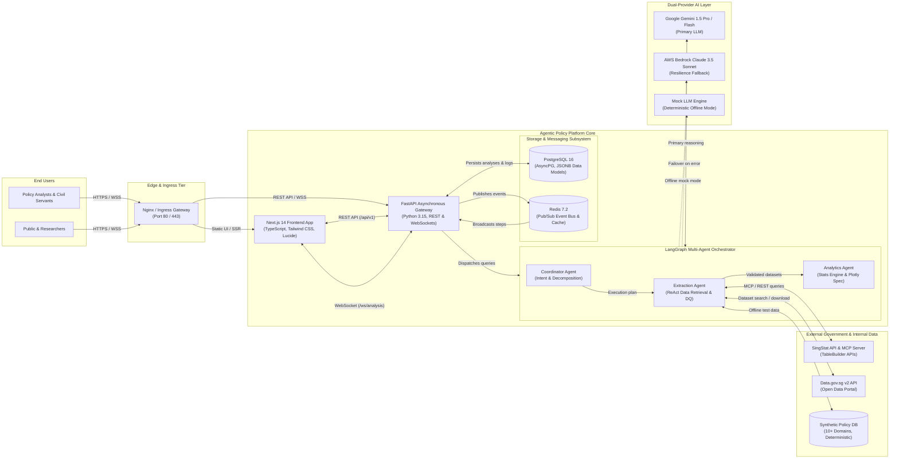
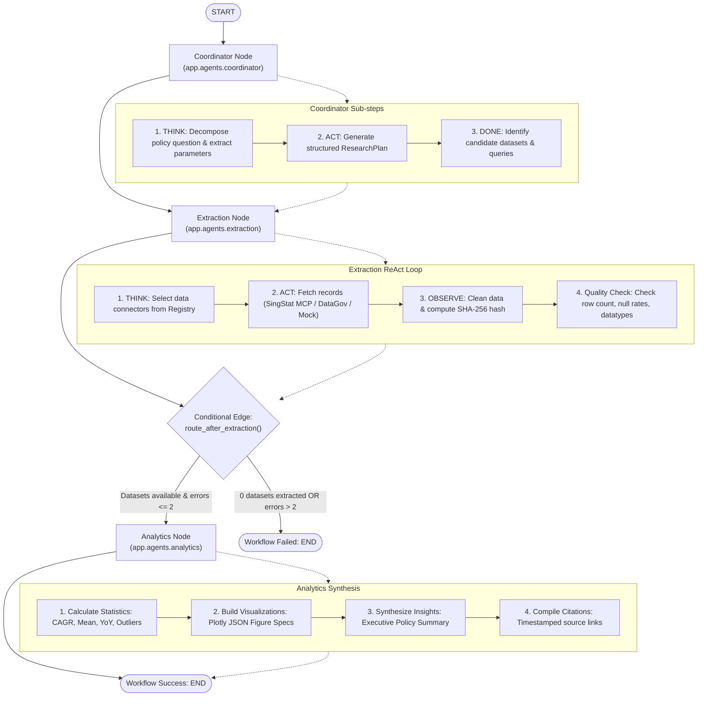
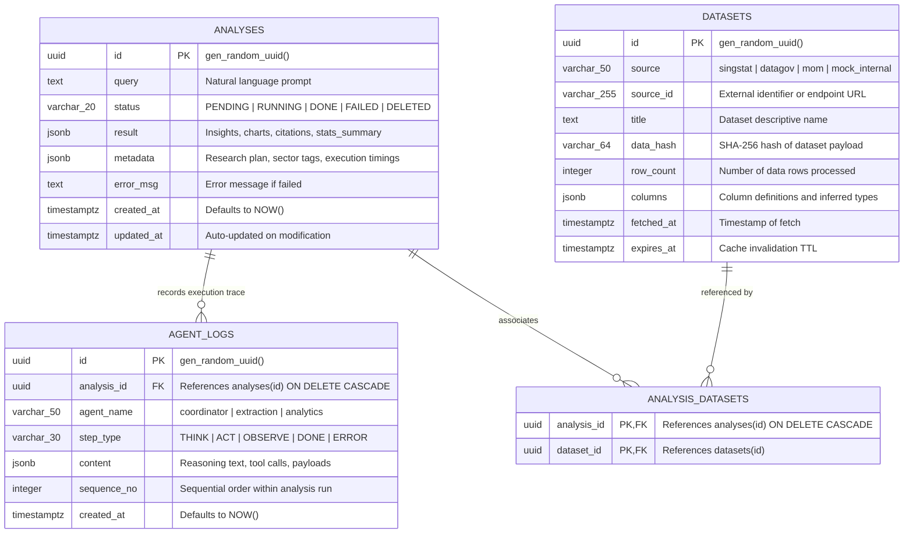
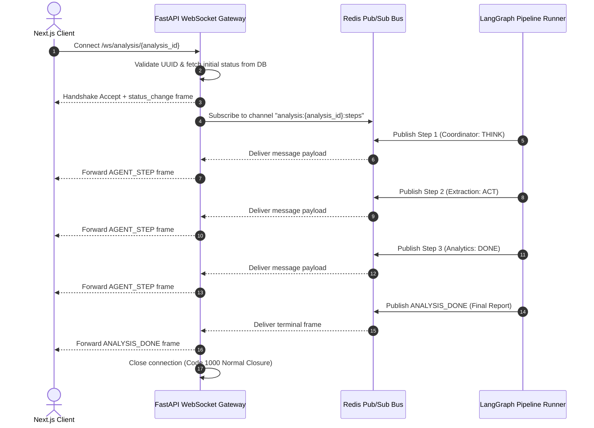
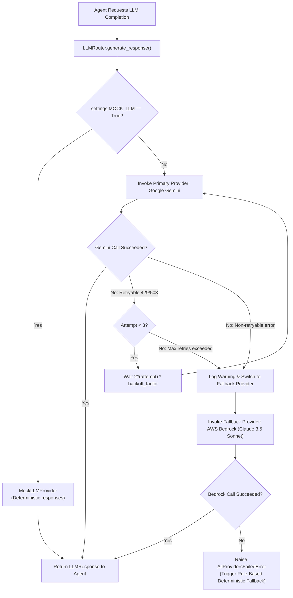
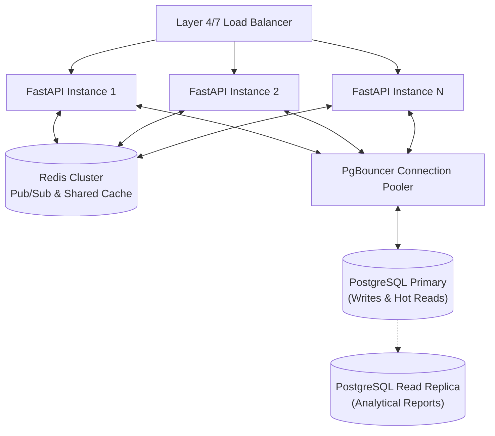

# 🏛️ Architecture Documentation
## Agentic Policy Data Analytics Platform

---

## 1. System Context

The **Agentic Policy Data Analytics Platform** transforms natural-language policy questions (e.g., *"What is the 5-year trend in Singapore's consumer price index and median household income?"*) into comprehensive, statistically validated analytical reports with interactive Plotly visualisations and verifiable citations.

The following context diagram illustrates the system boundaries, end-user actors, external government open-data providers, and cloud LLM endpoints:



---

## 2. Component Architecture

### 2.1 Next.js 14 Frontend UI Shell
- **Role**: Client interface providing interactive natural-language querying, real-time agent execution transparency, and rich analytical report consumption.
- **Key Modules**:
  - `QueryInput`: Natural language query submission bar with suggested domain query chips.
  - `AgentMonitor`: Streaming reasoning console rendering structured `THINK`, `ACT`, `OBSERVE`, and `ERROR` agent logs in real time.
  - `Dashboard`: Data presentation surface embedding dynamic Plotly visualizations, narrative insights, and statistical summary cards.
  - `CitationViewer`: Verifiable audit list showing data origins, source URLs, access timestamps, and schema metadata.
  - `AnalysisHistory`: Paginated searchable table of historical queries with single-click JSON export.

### 2.2 FastAPI Asynchronous Backend
- **Role**: High-performance asynchronous API gateway handling HTTP query lifecycle, WebSocket connection multiplexing, and agent pipeline scheduling.
- **Key Responsibilities**:
  - Exposes RESTful endpoints conforming to OpenAPI 3.0 specification.
  - Houses the background task dispatcher (`BackgroundTasks` / `asyncio.create_task`).
  - Manages real-time WebSocket communication sessions, decoupling message streams via Redis pub/sub.
  - Enforces input validation and payload bounds via Pydantic v2 schemas.

### 2.3 LangGraph Multi-Agent Orchestration Subsystem
- **Role**: Directed acyclic graph (DAG) state machine executing specialized ReAct and analytical tasks.
- **Agents**:
  1. **Coordinator Agent**: Parses policy queries, extracts sector/time parameters, formulates sub-tasks, and selects candidate datasets.
  2. **Extraction Agent**: Executes iterative data retrieval via tool calling, applies data cleaning, computes SHA-256 integrity hashes, and validates data quality.
  3. **Analytics Agent**: Computes descriptive and comparative statistics (CAGR, YoY growth, anomaly detection), generates portable Plotly JSON figures, and synthesizes policy narratives.

### 2.4 Data Sources & MCP Integration Layer
- **Role**: Decoupled connector ecosystem registered through a thread-safe `DataSourceRegistry`.
- **Connectors**:
  - `SingStatDataSource`: Interacts with Singapore Department of Statistics TableBuilder API and MCP endpoints.
  - `DataGovDataSource`: Queries Singapore Government open data CKAN / v2 REST endpoints.
  - `MockInternalDataSource`: Deterministic in-memory database spanning 10 key policy domains (CPI, GDP, Population, Housing, Employment, Healthcare, Education, Tourism, Energy, Transport).

### 2.5 LLM Routing & Resilience Engine
- **Role**: Resilient multi-provider client layer abstracting model invocations.
- **Capabilities**:
  - Primary provider: Google Gemini (`gemini-1.5-pro` / `gemini-1.5-flash`).
  - Fallback provider: AWS Bedrock (`anthropic.claude-3-5-sonnet-20241022-v2:0`).
  - Automated 3-attempt exponential backoff on retryable network or rate-limit HTTP errors (429, 503).
  - Instant transparent failover to secondary provider if primary fails completely.
  - Zero-credential offline operation via `MockLLMProvider` (`MOCK_LLM=true`).

### 2.6 Persistence Layer (PostgreSQL + Redis)
- **PostgreSQL 16**: Relational storage engine for analyses, agent log traces, and cached dataset schemas using JSONB columns for flexible data structures.
- **Redis 7.2**: Low-latency Pub/Sub broker broadcasting execution events between background worker threads and active WebSocket connections.

---

## 3. LangGraph Multi-Agent Flow

The multi-agent workflow is implemented as a compiled LangGraph `StateGraph`. Execution transitions deterministically from the **Coordinator** through the **Extraction** node, evaluates data quality and extraction success via a conditional routing edge, and proceeds to the **Analytics** node before terminating at `END`.



### 3.1 Shared State Definition (`AgentState`)

```python
class AgentState(TypedDict):
    analysis_id: str                      # Unique UUID for the analysis run
    query: str                            # Original natural-language question
    research_plan: ResearchPlan | None    # Sub-tasks, metrics, sector, time period
    selected_datasets: list[dict]         # Metadata of resolved target datasets
    raw_data: dict[str, Any]              # Cleaned tabular records per dataset
    statistical_results: dict[str, Any]   # Computed metrics (CAGR, mean, outliers)
    insights: list[str]                   # Bulleted policy takeaways
    citations: list[dict]                 # Traceable source references
    agent_logs: list[dict]                # Chronological trace of all agent steps
    current_agent: str                    # Active agent persona
    extraction_errors: list[str]          # Logged non-fatal and fatal errors
    final_report: dict[str, Any] | None   # Aggregated analytical result
    status: str                           # State: pending, running, completed, failed
```

---

## 4. Database Schema & Entity-Relationship Diagram

The platform utilizes PostgreSQL 16 with native JSONB columns to combine relational integrity with analytical flexibility.



### Indexes and Partitioning Strategy
- `idx_agent_logs_analysis`: B-Tree index on `(analysis_id, sequence_no)` ensures rapid sequential retrieval of step logs during WebSocket synchronization and page reloads.
- `idx_analyses_created_at`: Supports fast paginated timeline queries for past reports.
- `datasets(source, source_id)`: Accelerates cache hit detection when re-executing identical data fetches.

---

## 5. API Reference (RESTful Interface)

All REST endpoints reside under the `/api/v1` namespace.

### Summary Table

| Method | Endpoint | Description | Status Codes |
|---|---|---|---|
| `GET` | `/api/v1/health` | Service health (DB, Redis, LLM router) | `200` |
| `POST` | `/api/v1/analysis/start` | Submit natural-language query and enqueue job | `201`, `422`, `500` |
| `GET` | `/api/v1/analysis/{id}` | Fetch full analysis report and agent logs | `200`, `404` |
| `GET` | `/api/v1/analysis/` | Paginated list of active/completed analyses | `200` |
| `GET` | `/api/v1/analysis/{id}/export` | Download full report payload as JSON file | `200`, `404` |
| `DELETE` | `/api/v1/analysis/{id}` | Soft delete analysis record | `204`, `404` |

---

### Endpoint Specifications

#### 1. System Health Check
`GET /api/v1/health`

**Response (`200 OK`)**:
```json
{
  "status": "ok",
  "db": "ok",
  "redis": "ok",
  "llm": {
    "primary": { "provider": "gemini", "status": "ok", "latency_ms": 142.5 },
    "fallback": { "provider": "bedrock", "status": "ok", "latency_ms": 280.1 }
  },
  "timestamp": "2026-11-16T05:30:00Z",
  "environment": "development"
}
```

#### 2. Start Policy Analysis
`POST /api/v1/analysis/start`

**Request Body**:
```json
{
  "query": "Analyse Singapore's inflation rate and median household income over the past 5 years.",
  "metadata": {
    "requested_by": "analyst@gov.sg",
    "department": "Economic Planning"
  }
}
```

**Response (`201 Created`)**:
```json
{
  "analysis_id": "8f3b2049-74d6-4e58-9a67-27b2b0efbc91",
  "status": "PENDING",
  "ws_url": "ws://localhost:8000/ws/analysis/8f3b2049-74d6-4e58-9a67-27b2b0efbc91"
}
```

#### 3. Retrieve Analysis Details
`GET /api/v1/analysis/{id}`

**Response (`200 OK`)**:
```json
{
  "id": "8f3b2049-74d6-4e58-9a67-27b2b0efbc91",
  "query": "Analyse Singapore's inflation rate and median household income over the past 5 years.",
  "status": "DONE",
  "result": {
    "insights": [
      "Headline CPI grew at a compound annual rate of 3.8% between 2019 and 2024.",
      "Real median household income grew 2.1% annually, outpacing inflation after 2022."
    ],
    "charts": [
      {
        "data": [
          { "x": [2020, 2021, 2022, 2023, 2024], "y": [99.2, 101.5, 107.7, 112.9, 115.6], "type": "scatter", "name": "CPI" }
        ],
        "layout": { "title": "Singapore Consumer Price Index (2020-2024)" }
      }
    ],
    "citations": [
      {
        "source": "SingStat",
        "url": "https://tablebuilder.singstat.gov.sg/api/table/tabledata/M212881",
        "title": "Consumer Price Index, 2019=100",
        "accessed": "2026-11-16T05:32:00Z"
      }
    ],
    "stats_summary": {
      "mean_cpi": 107.38,
      "cagr": 0.0384,
      "latest_value": 115.6
    }
  },
  "agent_logs": [
    {
      "id": "11bb4a32-15f9-43f1-b844-0c58a5daec63",
      "analysis_id": "8f3b2049-74d6-4e58-9a67-27b2b0efbc91",
      "agent_name": "coordinator",
      "step_type": "THINK",
      "content": { "reasoning": "Decomposing query into CPI and household income datasets." },
      "sequence_no": 1,
      "created_at": "2026-11-16T05:30:05Z"
    }
  ],
  "created_at": "2026-11-16T05:30:00Z",
  "updated_at": "2026-11-16T05:30:25Z"
}
```

---

## 6. WebSocket Streaming Protocol

Clients connect to `ws://{host}/ws/analysis/{analysis_id}` to receive real-time streaming execution steps from the LangGraph agents.



### Frame Formats

#### 1. Agent Reasoning Step (`AGENT_STEP` / `agent_step`)
```json
{
  "type": "AGENT_STEP",
  "analysis_id": "8f3b2049-74d6-4e58-9a67-27b2b0efbc91",
  "agent": "extraction",
  "step_type": "ACT",
  "sequence_no": 4,
  "content": {
    "tool_name": "fetch_singstat_table",
    "parameters": { "table_id": "M212881" },
    "records_retrieved": 60
  },
  "timestamp": "2026-11-16T05:30:12Z"
}
```

#### 2. Workflow Terminal Completion (`ANALYSIS_DONE` / `complete`)
```json
{
  "type": "ANALYSIS_DONE",
  "analysis_id": "8f3b2049-74d6-4e58-9a67-27b2b0efbc91",
  "result": {
    "insights": ["CPI grew 3.8% annually..."],
    "charts": [{ "data": [], "layout": {} }],
    "citations": [{ "source": "SingStat", "url": "..." }],
    "stats_summary": { "cagr": 0.0384 }
  },
  "timestamp": "2026-11-16T05:30:25Z"
}
```

#### 3. Error Event (`ANALYSIS_ERROR` / `error`)
```json
{
  "type": "ANALYSIS_ERROR",
  "analysis_id": "8f3b2049-74d6-4e58-9a67-27b2b0efbc91",
  "error": "Dataset retrieval failed after 3 retry attempts.",
  "details": { "failed_source": "singstat", "table_id": "M999999" },
  "timestamp": "2026-11-16T05:30:15Z"
}
```

#### 4. Heartbeat Keepalive (`ping` / `pong`)
Sent every 60 seconds (configurable) to prevent proxy idle disconnection:
```json
{
  "type": "ping",
  "analysis_id": "8f3b2049-74d6-4e58-9a67-27b2b0efbc91",
  "timestamp": "2026-11-16T05:31:00Z"
}
```

---

## 7. LLM Integration & Resilience Layer

To guarantee high availability and prevent single-vendor lock-in, the platform integrates a dual-provider LLM routing layer behind a unified abstract interface (`AbstractLLMProvider`).



### Provider Matrix

| Identifier | Provider Class | Model ID | Primary Use Case |
|---|---|---|---|
| `gemini` | `GeminiProvider` | `gemini-1.5-pro` / `gemini-1.5-flash` | Default primary provider for reasoning & synthesis |
| `bedrock` | `BedrockProvider` | `anthropic.claude-3-5-sonnet-20241022-v2:0` | Enterprise AWS fallback failover |
| `openai` | `OpenAIProvider` | `gpt-4o` | Optional provider plugin |
| `anthropic` | `AnthropicProvider` | `claude-3-5-sonnet-20241022` | Optional direct Anthropic API provider |
| `mock` | `MockLLMProvider` | `mock-policy-analyst` | Offline unit tests, air-gapped CI/CD |

---

## 8. Data Source Integration & Extension Guide

External data connectors inherit from `AbstractDataSource` and are registered in `DataSourceRegistry`.

### Connector Architecture

```
AbstractDataSource (base.py)
   ├── SingStatDataSource      (SingStat TableBuilder REST & MCP)
   ├── DataGovDataSource       (Data.gov.sg v2 CKAN endpoints)
   └── MockInternalDataSource  (10 curated synthetic policy datasets)
```

### How to Add a New Data Source

To integrate a new government open data source (e.g., Monetary Authority of Singapore - MAS API):

1. **Create the Connector Module**:
   Create `backend/app/data_sources/mas.py` subclassing `AbstractDataSource`:

   ```python
   from app.data_sources.base import AbstractDataSource, DatasetMetadata, RawDataRecord

   class MASDataSource(AbstractDataSource):
       source_id = "mas"
       display_name = "Monetary Authority of Singapore API"

       async def search(self, query: str, limit: int = 5) -> list[DatasetMetadata]:
           # Implement API endpoint search logic
           ...

       async def fetch(self, dataset_id: str, **kwargs) -> list[RawDataRecord]:
           # Fetch records, normalize dates and numerical values
           ...

       async def health_check(self) -> bool:
           # Ping MAS health/status endpoint
           return True
   ```

2. **Register in Registry**:
   In `backend/app/data_sources/__init__.py` or during app startup:

   ```python
   from app.data_sources.mas import MASDataSource
   from app.data_sources.registry import DataSourceRegistry

   registry = DataSourceRegistry()
   registry.register(MASDataSource())
   ```

3. **Expose Extraction Tool**:
   Add the tool wrapper in `backend/app/agents/tools/data_tools.py` so the extraction agent's ReAct prompt recognizes the new source.

---

## 9. Architecture Decision Records (ADRs)

### ADR-01: Agent Framework Selection
- **Status**: Accepted
- **Context**: The platform requires structured reasoning, stateful multi-step execution, tool usage for data retrieval, and dynamic routing based on extraction quality.
- **Options Considered**:
  1. *LangChain (standard chains / Agents)*: High abstraction level, opaque state management, difficult to debug multi-step loops.
  2. *AutoGen / CrewAI*: Conversational agent paradigms; prone to runaway chat loops without strict deterministic state transitions.
  3. *Custom State Machine (Pure Python asyncio)*: Complete control, but requires reinventing graph topologies, conditional branching, and checkpointing.
  4. *LangGraph*: Graph-based state machine architecture natively supporting ReAct cycles, typed state (`AgentState`), and deterministic conditional branching.
- **Decision**: **LangGraph**.
- **Trade-offs**: LangGraph provides explicit, transparent edge definitions (`route_after_extraction`) and isolated node execution, making debugging and unit testing deterministic. Slightly higher initial boilerplate compared to simple chains.

---

### ADR-02: Backend API Framework
- **Status**: Accepted
- **Context**: The system must handle long-running analytical queries (10–30s) concurrently with real-time WebSocket event streaming.
- **Options Considered**:
  1. *Django + Channels*: Heavyweight ORM and configuration overhead for an API-first analytics service.
  2. *Flask*: Synchronous by default; poorly suited for native WebSocket streaming without Gevent/Eventlet.
  3. *FastAPI*: Native `asyncio`, high throughput, automatic OpenAPI documentation, and seamless Pydantic v2 serialization.
- **Decision**: **FastAPI**.
- **Trade-offs**: FastAPI delivers superior async concurrency with low memory footprint. Requires careful discipline to avoid blocking the event loop with synchronous statistical computations (delegated to worker threads where needed).

---

### ADR-03: Database & Result Storage Strategy
- **Status**: Accepted
- **Context**: Analytical outputs include diverse JSON structures: variable-length insights, arbitrary tabular time-series columns, and deeply nested Plotly chart definitions.
- **Options Considered**:
  1. *Rigid Normalized Schema (e.g., separate tables for chart series, data points, citations)*: High schema migration friction whenever chart types or data attributes change.
  2. *Pure NoSQL (MongoDB)*: Flexible schema, but loses relational integrity between analyses, user audit logs, and external dataset caching.
  3. *PostgreSQL with JSONB*: Combines ACID compliance and foreign-key constraints with flexible, indexable binary JSON columns.
- **Decision**: **PostgreSQL 16 with JSONB**.
- **Trade-offs**: Provides strong relational consistency for the analysis workflow (`analyses`, `agent_logs`, `datasets`) while allowing dynamic storage for narrative results and Plotly JSON specifications without database migrations.

---

### ADR-04: Chart Generation & Serialization Strategy
- **Status**: Accepted
- **Context**: Policy visualizations must render identically across web, mobile, and exportable JSON formats without discrepancies between frontend and backend interpretations.
- **Options Considered**:
  1. *Backend Server-Side Rendering (SSR) to PNG/SVG*: Static images; loses tooltip inspection, zooming, and client-side interactivity.
  2. *Frontend D3/Chart.js code dynamically written by LLM*: Code execution security risks (arbitrary JS execution) and high hallucination rate for syntax.
  3. *Backend Plotly Python Figure -> JSON Specification -> Frontend Plotly React*: Secure, portable, declarative JSON specification.
- **Decision**: **Server-side Plotly JSON generation**.
- **Trade-offs**: The backend analytics agent generates structured Plotly figure dictionaries. The frontend renders them via standard Plotly.js / react-plotly.js. This guarantees interactive data exploration with zero client-side code execution vulnerabilities.

---

### ADR-05: Real-Time Communication & Decoupling
- **Status**: Accepted
- **Context**: Multi-agent reasoning steps must stream to the client interface in real time as they occur.
- **Options Considered**:
  1. *Client HTTP Polling (every 1s)*: Inefficient, high latency, unnecessary database query load.
  2. *Server-Sent Events (SSE)*: Unidirectional; simple but lacks bidirectional protocol extensibility (e.g. client heartbeats/cancellations).
  3. *Redis Pub/Sub + WebSockets*: High performance, decoupled, supports horizontal scaling across multiple backend instances.
- **Decision**: **Redis Pub/Sub backed WebSockets**.
- **Trade-offs**: Background workers publish events to `analysis:{id}:steps` on Redis; any connected FastAPI worker subscribed to the channel pushes frames to the client WebSocket. Supports multiple concurrent viewers per analysis session.

---

### ADR-06: Dual-Provider LLM Resilience
- **Status**: Accepted
- **Context**: Commercial LLM APIs experience rate limits (HTTP 429), temporary outages, or regional latency spikes. A mission-critical policy platform cannot fail due to a single vendor outage.
- **Options Considered**:
  1. *Single Provider with Retries*: Ineffective during extended vendor outages or quota exhaustion.
  2. *Load-Balanced Model Gateway (e.g., LiteLLM proxy)*: Adds another infrastructure component to deploy and manage.
  3. *In-Application Dual-Provider Router (Gemini primary -> Bedrock fallback)*: Zero external proxy dependency, automatic retry with exponential backoff, and transparent failover.
- **Decision**: **In-Application LLMRouter (Gemini + Bedrock)**.
- **Trade-offs**: Protects platform uptime by seamlessly switching providers. Requires maintaining prompt compatibility across both Gemini and Claude model families.

---

### ADR-07: Offline Deterministic Mock Mode
- **Status**: Accepted
- **Context**: Development, CI/CD pipelines, and air-gapped evaluation environments must function without live external API keys or paid credits.
- **Options Considered**:
  1. *Mock external network calls using VCR.py / WireMock*: Fragile recorded HTTP traces that break when external schemas evolve.
  2. *Fully Integrated Synthetic Mock Engine*: Embedded synthetic data repository and keyword-aware mock LLM provider.
- **Decision**: **MockLLMProvider & MockInternalDataSource enabled via environment flags (`MOCK_LLM=true`, `USE_MOCK_DATA_SOURCES=true`)**.
- **Trade-offs**: 100% of test suites and CI runs execute deterministically without network calls or external API bills.

---

## 10. Scalability & Operational Considerations



### Key Scaling Dimensions
1. **Stateless API Tier**: FastAPI instances maintain no in-memory session state. WebSockets rely on Redis Pub/Sub, allowing arbitrary horizontal scaling behind an ingress reverse proxy.
2. **Database Connection Pooling**: Built-in SQLAlchemy async pooling with `pool_size=20` and `max_overflow=10`, prepared for PgBouncer in enterprise clusters.
3. **Background Worker Decoupling**: Currently executed via `asyncio` background tasks. The architecture isolates pipeline execution within `AnalysisService.run_pipeline`, enabling zero-refactor migration to Celery, ARQ, or AWS SQS workers as volume increases.
4. **Caching & Deduplication**: External data queries check the `datasets` table by SHA-256 hash and TTL (`expires_at`), preventing redundant outbound HTTP calls to government portals.

---

## 11. Implementation Notes & Reality Grounding

- **Rule-Based Coordinator Fallback**: In the event that both LLM providers encounter timeouts, the Coordinator agent features an automated rule-based keyword parser that extracts domain topics (CPI, GDP, Population, Housing) to prevent pipeline blockage.
- **Statistical Sanitization**: Raw time-series computations strip `NaN`, `+Infinity`, and `-Infinity` values before JSON serialization, guaranteeing schema compliance with Pydantic and JSONB specifications.
- **Data Quality Thresholds**: The Extraction agent rejects datasets where null value density exceeds 40% or row count is less than 3, immediately triggering error logging and graceful failure reporting.
- **Soft Delete Compliance**: Analyses flagged for deletion via `DELETE /api/v1/analysis/{id}` update status to `DELETED`, preserving audit records while filtering items out of UI lists and single-item queries.
