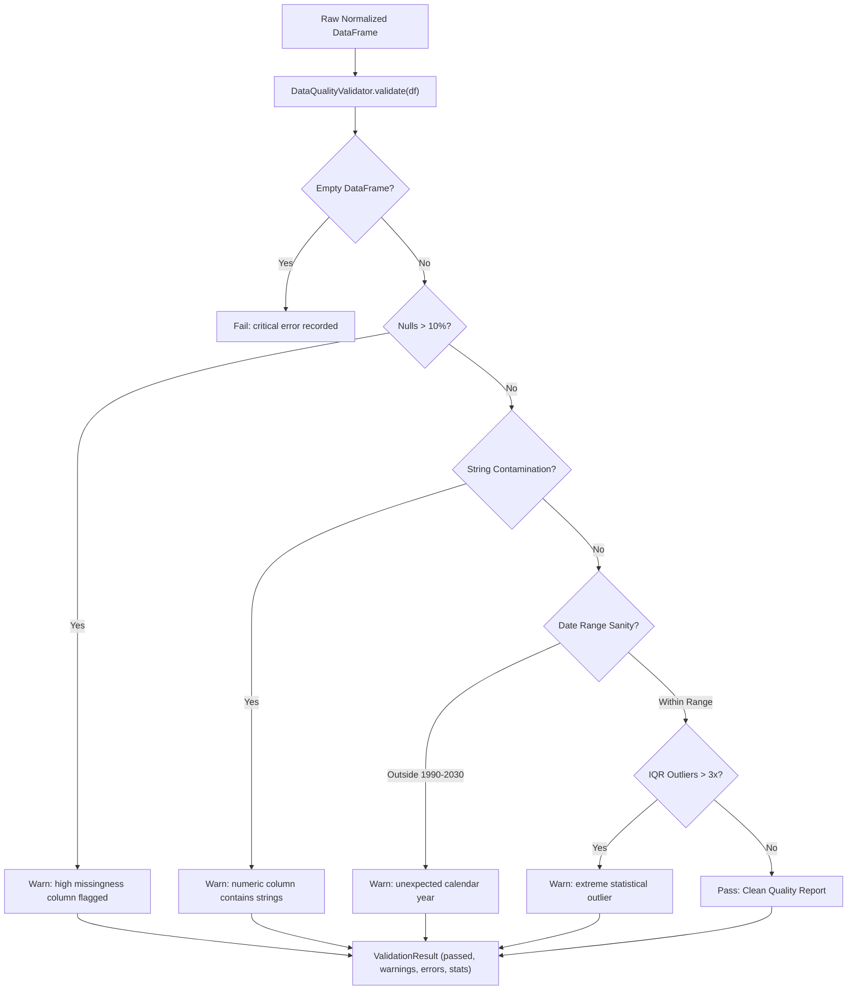

# 📊 Data Sources & Connector Architecture

Comprehensive data architecture guide for the **Agentic Policy Data Analytics Platform**. This document details the external government open-data APIs integrated into the platform, the offline benchmark simulation engine, encountered data quality anomalies and mitigation strategies, and the procedure for registering new data sources.

---

## 📑 Table of Contents

- [🏛️ Overview & Integration Principles](#️-overview--integration-principles)
- [📈 SingStat Table Builder REST API](#-singstat-table-builder-rest-api)
  - [Endpoints & Specifications](#endpoints--specifications)
  - [Authentication & Rate Limiting](#authentication--rate-limiting)
  - [Sample Response Payload (Truncated)](#sample-response-payload-truncated)
- [🇸🇬 Data.gov.sg CKAN Action API](#-datagovsg-ckan-action-api)
  - [Endpoints & Specifications](#endpoints--specifications-1)
  - [Authentication & Authorization](#authentication--authorization)
  - [Sample Response Payload (Truncated)](#sample-response-payload-truncated-1)
- [📦 Mock Internal Database (`MockInternalDataSource`)](#-mock-internal-database-mockinternaldatasource)
  - [Role & Trigger Conditions](#role--trigger-conditions)
  - [Benchmark Datasets Catalog](#benchmark-datasets-catalog)
  - [Economic & Policy Assumptions](#economic--policy-assumptions)
- [🛡️ Data Quality Validation Pipeline](#️-data-quality-validation-pipeline)
  - [Observed Anomalies & Non-Destructive Mitigations](#observed-anomalies--non-destructive-mitigations)
- [🔄 Caching & Data Refresh Strategy](#-caching--data-refresh-strategy)
- [🔌 How to Add a New Data Source (3-Step Guide)](#-how-to-add-a-new-data-source-3-step-guide)

---

## 🏛️ Overview & Integration Principles

The platform ingests official macroeconomic, demographic, and labor market indicators published by the Government of Singapore. Because public policy analytics requires strict auditability and provenance tracking, our data layer enforces four core rules:

1. **Uniform Data Contract**: All data connectors implement `AbstractDataSource` ([base.py](file:///Users/sathish/Documents/PolicyDataAnalytics/backend/app/data_sources/base.py)), producing standardized `pandas.DataFrame` structures with lowercase column names, snake_case formatting, and UTC temporal localization.
2. **Deterministic Metadata Auditing**: Every retrieved DataFrame is stamped with internal audit columns: `_source` (e.g., `"singstat"`, `"datagov"`, `"mock"`) and `_fetched_at` (ISO 8601 UTC timestamp).
3. **Resilient Circuit Breaking & Mock Fallbacks**: Live network requests that fail, time out after 30 seconds, or encounter HTTP 429 rate limits automatically fall back to the pre-loaded `MockInternalDataSource`. The application never crashes due to upstream government API downtime.
4. **Content-Addressed Deduplication**: Retrieved tables are hashed using SHA-256 and persisted in PostgreSQL to avoid redundant API queries.

### 📁 Multi-Format Data Ingestion Support (CSV, Excel, JSON, APIs)

Singapore government data releases vary significantly by publishing ministry. The platform features native ingestion adapters for all four required formats:

| Format | Source Examples | Parsing Engine | Ingestion Mechanism |
|:---|:---|:---|:---|
| **REST & CKAN APIs** | SingStat Table Builder, Data.gov.sg Datastore | `httpx.AsyncClient` | Asynchronous HTTP with rate-limiting, bearer token injection, and health checks |
| **JSON (Hierarchical & Flat)** | SingStat nested `{"data": {"row": [...]}}`, CKAN `result.records` | `json` / `pandas` | Unrolls hierarchical series names and column vectors into normalized long-format time series |
| **CSV** | Data.gov.sg raw resource downloads, MOM static time series | `pd.read_csv(io.StringIO(text))` | Auto-detects delimiters, strips BOM headers, and parses temporal indices |
| **Excel (.xlsx / .xls)** | MOM Manpower Research & Statistics, SingStat Excel workbooks | `openpyxl` / `pd.read_excel(io.BytesIO(bytes))` | Detects openxml / OLE magic bytes (`PK\x03\x04`), parses multi-sheet workbooks, and cleans merged title rows |

---

## 📈 SingStat Table Builder REST API

The **Singapore Department of Statistics (SingStat)** Table Builder API provides programmatic access to official time-series tables, national accounts, consumer price indices, and demographic breakdowns.

- **Base URL**: `https://tablebuilder.singstat.gov.sg/api/table`
- **Official Documentation**: [SingStat Table Builder API Guide](https://tablebuilder.singstat.gov.sg/api-info)
- **Connector Implementation**: [singstat.py](file:///Users/sathish/Documents/PolicyDataAnalytics/backend/app/data_sources/singstat.py)

### Endpoints & Specifications

| Action | HTTP Method | Endpoint | Query Parameters | Description |
|---|---|---|---|---|
| **Table Search** | `GET` | `/search` | `keyword` (str, required) | Searches catalog for matching statistical tables. |
| **Table Data** | `GET` | `/tabledata/{id}` | Path parameter: `{id}` (e.g., `M810361`) | Fetches raw multi-dimensional time series data for table. |
| **Health Check** | `GET` | `/search?keyword=employment` | Probes API reachability with a 5.0s timeout. | Ping monitor. |

### Authentication & Rate Limiting

- **Authentication**: Optional Bearer token or custom header depending on access tier:
  ```http
  Authorization: Bearer <SINGSTAT_API_KEY>
  api-key: <SINGSTAT_API_KEY>
  User-Agent: AgenticPolicyPlatform/1.0
  ```
- **Configuration**: Controlled by `SINGSTAT_API_KEY` in `.env`.
- **Rate Limits**:
  - Unauthenticated / Free Tier: ~60 requests/minute.
  - Burst Allowance: Up to 10 requests/second.
  - Exceeding limits returns `HTTP 429 Too Many Requests`. The connector catches this and automatically engages fallback.

### Sample Response Payload (Truncated)

SingStat returns a hierarchical JSON envelope containing metadata and a row-column matrix:

```json
{
  "status": 200,
  "message": "success",
  "data": {
    "id": "M810361",
    "title": "Gross Domestic Product In Chained (2015) Dollars, By Industry",
    "frequency": "Quarterly",
    "unitOfMeasure": "Million Dollars",
    "row": [
      {
        "rowText": "Total Gross Domestic Product",
        "columns": [
          { "key": "2023 1Q", "value": "129841.4" },
          { "key": "2023 2Q", "value": "131420.8" },
          { "key": "2023 3Q", "value": "134102.1" },
          { "key": "2023 4Q", "value": "136950.5" },
          { "key": "2024 1Q", "value": "133290.0" }
        ]
      },
      {
        "rowText": "Manufacturing",
        "columns": [
          { "key": "2023 1Q", "value": "26120.3" },
          { "key": "2023 2Q", "value": "25890.1" },
          { "key": "2023 3Q", "value": "26450.7" },
          { "key": "2023 4Q", "value": "27810.0" },
          { "key": "2024 1Q", "value": "25710.2" }
        ]
      }
    ]
  }
}
```

*The connector parses this nested row/columns format and normalizes it into a flat, long-format time series DataFrame.*

---

## 🇸🇬 Data.gov.sg CKAN Action API

**Data.gov.sg** is Singapore's central open-data portal, operated by the Government Technology Agency (GovTech). The platform exposes a CKAN-compliant REST API for dataset discovery and tabular resource querying.

- **Base URL**: `https://data.gov.sg/api`
- **Official Documentation**: [Data.gov.sg Developer Portal](https://guide.data.gov.sg/)
- **Connector Implementation**: [datagov.py](file:///Users/sathish/Documents/PolicyDataAnalytics/backend/app/data_sources/datagov.py)

### Endpoints & Specifications

| Action | HTTP Method | Endpoint | Parameters | Description |
|---|---|---|---|---|
| **Package Search** | `GET` | `/action/package_search` | `q` (query), `rows` (limit) | Searches dataset packages matching policy keywords. |
| **Datastore Search** | `GET` | `/action/datastore_search` | `resource_id` (str, required), `limit` (int) | Queries tabular datastore records directly. |
| **Health Check** | `GET` | `/action/package_search?rows=1` | Probes CKAN portal availability with a 5.0s timeout. | Ping monitor. |

### Authentication & Authorization

- **Authentication**: Bearer token via `DATAGOV_API_TOKEN` environment variable:
  ```http
  Authorization: Bearer <DATAGOV_API_TOKEN>
  User-Agent: AgenticPolicyPlatform/1.0
  ```
- **Rate Limits**: 100 requests per minute per IP or API key.

### Sample Response Payload (Truncated)

Datastore search returns tabular records as a JSON list of dictionaries:

```json
{
  "help": "https://data.gov.sg/api/3/action/help_show?name=datastore_search",
  "success": true,
  "result": {
    "resource_id": "d_859580a5e849206d289196b6133eb1f9",
    "fields": [
      { "type": "int4", "id": "_id" },
      { "type": "text", "id": "year" },
      { "type": "text", "id": "industry" },
      { "type": "numeric", "id": "employed_count" },
      { "type": "numeric", "id": "growth_rate" }
    ],
    "records": [
      {
        "_id": 1,
        "year": "2022",
        "industry": "Information & Communications",
        "employed_count": 142800,
        "growth_rate": 7.4
      },
      {
        "_id": 2,
        "year": "2023",
        "industry": "Information & Communications",
        "employed_count": 154100,
        "growth_rate": 7.9
      }
    ],
    "total": 48
  }
}
```

---

## 📦 Mock Internal Database (`MockInternalDataSource`)

Located at [mock_internal.py](file:///Users/sathish/Documents/PolicyDataAnalytics/backend/app/data_sources/mock_internal.py), the mock internal data source provides offline statistical datasets modeled directly from real-world Singapore administrative records.

### Role & Trigger Conditions

The mock data source is activated when:
1. `USE_MOCK_DATA_SOURCES=true` is set in the `.env` file (standard configuration for testing, Docker dev, and evaluation).
2. Live calls to SingStat or Data.gov.sg experience HTTP errors (5xx, 404, 429) or exceed the 30-second request timeout.
3. Offline developer environments lack external outbound internet access.

### Benchmark Datasets Catalog

The mock database contains **5 comprehensive Singapore benchmark datasets** covering annual and quarterly periods from 2019 to 2024:

```mermaid
classDiagram
    class MockInternalDataSource {
        +search(keywords, **filters) list
        +fetch(dataset_id) DataFrame
        +health_check() bool
    }

    class EmploymentBySector {
        +ID: employment_by_sector / M810361
        +Source: MOM / SingStat Benchmark
        +Coverage: 2019–2024 (Annual)
        +Records: 66 rows (11 Sectors)
        +Attributes: year, sector, employment_count, yoy_change_pct
    }

    class ICTWorkforceTrends {
        +ID: ict_workforce_trends / d_859580a5e849206d289196b6133eb1f9
        +Source: IMDA / MOM Benchmark
        +Coverage: 2019–2024 (Annual)
        +Records: 6 rows
        +Attributes: year, tech_workforce, total_workforce, tech_penetration_pct
    }

    class UnemploymentRateQuarterly {
        +ID: unemployment_rate_quarterly / M810451
        +Source: MOM Benchmark
        +Coverage: 2019 Q1 – 2024 Q4 (Quarterly)
        +Records: 24 rows
        +Attributes: quarter, overall_rate, resident_rate, citizen_rate, youth_rate
    }

    class MedianGrossWages {
        +ID: median_gross_wages / M850001
        +Source: SingStat / MOM Comprehensive Wage Survey
        +Coverage: 2019–2024 (Annual)
        +Records: 30 rows (5 Occupation Groups)
        +Attributes: year, occupation_group, median_gross_monthly_sgd, pmet_indicator
    }

    class BusinessRegistrations {
        +ID: business_registrations / d_9410118e69ba339d2ecb313efef8bf91
        +Source: ACRA Benchmark
        +Coverage: 2019–2024 (Annual)
        +Records: 36 rows (6 Industries)
        +Attributes: year, industry, new_company_registrations, business_cessations, net_formation
    }

    MockInternalDataSource --> EmploymentBySector
    MockInternalDataSource --> ICTWorkforceTrends
    MockInternalDataSource --> UnemploymentRateQuarterly
    MockInternalDataSource --> MedianGrossWages
    MockInternalDataSource --> BusinessRegistrations
```



#### 1. Employment by Sector (`employment_by_sector` / `M810361`)
- **Coverage**: 11 sectors (Manufacturing, Construction, Wholesale & Retail, Transportation & Storage, Accommodation & Food, Info-Comm, Financial & Insurance, Real Estate, Professional Services, Admin & Support, Community & Social).
- **Metrics**: Headcount in thousands (`employment_count`), year-over-year percentage change (`yoy_change_pct`).

#### 2. ICT Workforce Trends (`ict_workforce_trends` / `d_859580a5e849206d289196b6133eb1f9`)
- **Coverage**: Tech workforce headcounts from 2019 to 2024.
- **Metrics**: `tech_workforce_count` (118.5k in 2019 to 164.2k in 2024), `total_workforce_count`, `tech_penetration_pct` (3.14% to 4.22%), and `tech_growth_pct`.

#### 3. Quarterly Unemployment Rate (`unemployment_rate_quarterly` / `M810451`)
- **Coverage**: 24 consecutive quarters from 2019 Q1 to 2024 Q4.
- **Metrics**: Seasonally adjusted rates for `overall_rate`, `resident_rate`, `citizen_rate`, and `youth_under_30_rate`.

#### 4. Median Gross Wages by Occupation (`median_gross_wages` / `M850001`)
- **Coverage**: Major standard occupational groups (PMETs, Clerical Support, Service & Sales, Production & Craft, Cleaners & Laborers).
- **Metrics**: Median gross monthly wage in SGD (including employer CPF). E.g., PMET median wages increasing from SGD 5,800 (2019) to SGD 7,300 (2024).

#### 5. Business Entity Registrations (`business_registrations` / `d_9410118e69ba339d2ecb313efef8bf91`)
- **Coverage**: ACRA business formations and closures across 6 industries.
- **Metrics**: `new_company_registrations`, `business_cessations`, `net_formation`.

---

### Economic & Policy Assumptions

All synthetic data adheres to realistic macroeconomic constraints:
- **COVID-19 Shock (2020)**: Sharp contraction in Accommodation & Food ($-15.8\%$), Construction ($-10.8\%$), and spike in overall unemployment to $3.5\%$ in 2020 Q3.
- **ICT Resilience**: Continuous positive net hiring throughout the pandemic, reflecting Singapore's Smart Nation digitalization push.
- **Post-COVID Labor Tightness (2022–2024)**: Rapid wage growth and rebound in net enterprise formations.

---

## 🛡️ Data Quality Validation Pipeline

Implemented in [data_service.py](file:///Users/sathish/Documents/PolicyDataAnalytics/backend/app/services/data_service.py) via `DataQualityValidator`, incoming data is audited across 5 dimensions:



### Observed Anomalies & Non-Destructive Mitigations

| Observed Data Quality Issue | Real-World Context in SG Datasets | System Mitigation |
|---|---|---|
| **Empty or Missing DataFrames** | Intermittent search query mismatches or empty API pages. | Returns structured `ValidationResult(passed=False)` without raising unhandled exceptions; routes query to mock dataset fallback. |
| **Inconsistent Null Tokens** | SingStat and Data.gov.sg use `"na"`, `"-"`, `"--"`, `"nil"`, or `"s"` (suppressed for confidentiality). | Normalization parses tokens into standard `numpy.nan`. If column missingness exceeds $10\%$, a warning is logged in metadata. |
| **String Contamination in Metrics** | Numeric figures formatted with currency prefixes (`"$5,400"`), commas (`"1,240"`), or percentage signs (`"3.5%"`). | String cleaning strips commas and non-numeric artifacts before type coercion. Non-coercible values are flagged. |
| **Date & Calendar Year Anomalies** | Corrupted dates, future projections beyond 2030, or timestamps prior to 1990. | Checked against allowable range $[1990, 2030]$. Anomalous rows are flagged in validation metadata without discarding adjacent valid rows. |
| **Extreme Statistical Outliers** | Typographical data entry errors (e.g., headcount inflated by $1000\times$). | Evaluates interquartile range ($\text{IQR} = Q_3 - Q_1$). Values beyond $\text{Median} \pm 3 \times \text{IQR}$ generate non-blocking advisory warnings. |
| **SingStat Nested Matrix Structure** | SingStat returns table rows as series text with nested columns objects. | Flattened dynamically into standard relational time series tuples `(series, period, value)` in `_parse_table_response()`. |

---

## 🔄 Caching & Data Refresh Strategy

To minimize external API latency and respect government portal rate limits, datasets are cached in PostgreSQL:

1. **Deterministic Hashing**: When a DataFrame is fetched and normalized, its JSON representation is hashed using SHA-256:
   $$\text{Hash} = \text{SHA-256}(\text{df.to\_json}())$$
2. **PostgreSQL Cache Model**: The `datasets` table stores `data_hash`, `source`, `source_id`, `row_count`, `columns` schema, `fetched_at`, and `expires_at`.
3. **TTL Expiration Policy**:
   - High-Frequency Datasets (e.g., monthly CPI, quarterly labor): Default **7-day TTL**.
   - Low-Frequency Datasets (e.g., annual census, 5-year benchmarks): Default **30-day TTL**.
   - When a dataset is requested, the system verifies:
     $$\text{datetime.now}(\text{UTC}) \le \text{Dataset.expires\_at}$$
     If expired, the background worker schedules an asynchronous refresh while returning the warm cached copy to maintain low user response times.

---

## 🔌 How to Add a New Data Source (3-Step Guide)

Adding a new data source connector (such as LTA DataMall, URA Real Estate API, or MAS Financial Statistics) takes 3 steps:

### Step 1: Subclass `AbstractDataSource`

Create a new connector file in `backend/app/data_sources/my_source.py`:

```python
# backend/app/data_sources/my_source.py
from typing import Any
import httpx
import pandas as pd
from app.data_sources.base import AbstractDataSource

class MyGovDataSource(AbstractDataSource):
    """Custom data source connector for MyGov statistical portal."""
    
    source_id: str = "mygov"
    display_name: str = "MyGov Statistical Portal"
    BASE_URL: str = "https://api.mygov.sg/v1"

    async def search(self, keywords: str | list[str], **filters: Any) -> list[dict[str, Any]]:
        # Implement catalog discovery
        kw = " ".join(keywords) if isinstance(keywords, list) else str(keywords)
        async with httpx.AsyncClient(timeout=10.0) as client:
            resp = await client.get(f"{self.BASE_URL}/datasets", params={"query": kw})
            resp.raise_for_status()
            data = resp.json()
            return [
                {
                    "id": item["id"],
                    "title": item["title"],
                    "description": item["description"],
                    "format": "tabular",
                }
                for item in data.get("items", [])
            ]

    async def fetch(self, dataset_id: str) -> pd.DataFrame:
        # Fetch raw records and normalize via base class
        async with httpx.AsyncClient(timeout=30.0) as client:
            resp = await client.get(f"{self.BASE_URL}/data/{dataset_id}")
            resp.raise_for_status()
            raw_df = pd.DataFrame(resp.json()["records"])
            
            # Normalize column names, timestamps, and metadata
            return self.normalize_dataframe(raw_df, metadata={"source": self.source_id, "dataset_id": dataset_id})

    async def health_check(self) -> bool:
        # 5-second reachability probe
        try:
            async with httpx.AsyncClient(timeout=5.0) as client:
                resp = await client.get(f"{self.BASE_URL}/health")
                return resp.status_code == 200
        except Exception:
            return False
```

### Step 2: Register in `DataSourceRegistry`

Import and register your connector in [backend/app/data_sources/registry.py](file:///Users/sathish/Documents/PolicyDataAnalytics/backend/app/data_sources/registry.py):

```python
from app.data_sources.registry import data_source_registry
from app.data_sources.my_source import MyGovDataSource

# Instantiate and register connector
mygov_source = MyGovDataSource()
data_source_registry.register(mygov_source)
```

### Step 3: Done! Automated Discovery

The multi-agent system automatically discovers registered data sources:
- The **Coordinator Agent** incorporates the new data source into its research plans.
- The **Extraction Agent** queries the source during ReAct retrieval loops using `data_source_registry.get("mygov")`.
- Data quality validation, SHA-256 deduplication, and hallucination grounding checks will automatically apply.
