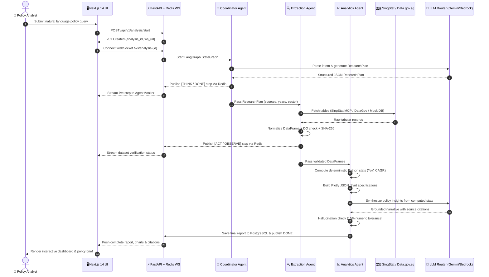

# 🏛️ Agentic Policy Data Analytics Platform

[](https://www.python.org/)
[](https://fastapi.tiangolo.com/)
[](https://nextjs.org/)
[](https://www.typescriptlang.org/)
[](https://langchain-ai.github.io/langgraph/)
[](https://www.docker.com/)
[](TESTING.md)
[](TESTING.md)
[](LICENSE)

An enterprise-grade, autonomous multi-agent intelligence platform engineered for **policy researchers, economists, and public-sector analysts**. The platform translates high-level natural language policy inquiries into deterministic, statistically rigorous analytical pipelines—autonomously extracting, validating, reconciling, and visualizing official Singapore government statistics from **SingStat (MCP & TableBuilder)**, **Data.gov.sg v2**, and national economic benchmarks.

Built with **LangGraph** stateful multi-agent workflows, **FastAPI**, **Next.js 14**, and resilient multi-model LLM routing across **Google Gemini**, **Amazon Bedrock**, and **offline deterministic mock providers**.

---

### ⚡ 30-Second Quick Start (Zero Cloud Spend / Offline Mode)

Launch the entire containerized stack immediately—no external API keys or cloud accounts required:

```bash
# 1. Clone repository & enter workspace
git clone https://github.com/your-org/policy-data-analytics.git
cd policy-data-analytics

# 2. Copy environment template (pre-configured with offline mock mode by default)
cp .env.example .env

# 3. Start all 5 services with Docker Compose (or: make start)
docker compose up -d
```

Open your browser:
- 🖥️ **Web Dashboard**: [http://localhost](http://localhost) (or [http://localhost:3000](http://localhost:3000))
- 📖 **Interactive API Docs**: [http://localhost:8000/docs](http://localhost:8000/docs)
- 🩺 **Health Check**: [http://localhost:8000/api/v1/health](http://localhost:8000/api/v1/health)

---

## 📑 Table of Contents

- [✨ Key Platform Capabilities](#-key-platform-capabilities)
- [🖥️ Application Showcase: Dynamic UI, Interactive Visualizations & Grounded Citations](#️-application-showcase-dynamic-ui-interactive-visualizations--grounded-citations)
  - [1. National Policy Intelligence Dashboard](#1-national-policy-intelligence-dashboard)
  - [2. Natural Language Query Console ("Ask Me The Stats")](#2-natural-language-query-console-ask-me-the-stats)
  - [3. Dynamic Query-Driven UI & Contextual Metric Cards](#3-dynamic-query-driven-ui--contextual-metric-cards)
  - [4. Dynamic Interactive Visualizations (Plotly & Recharts)](#4-dynamic-interactive-visualizations-plotly--recharts)
  - [5. Grounded Narrative Synthesis & Fact-Checked Insights](#5-grounded-narrative-synthesis--fact-checked-insights)
  - [6. Verifiable Government Citations & Audit Trail](#6-verifiable-government-citations--audit-trail)
  - [7. Real-Time Multi-Agent ReAct Execution Stream](#7-real-time-multi-agent-react-execution-stream)
- [🏗️ System Architecture — High-Level Design (HLD)](#️-system-architecture--high-level-design-hld)
  - [1. System Context & Layered HLD Diagram](#1-system-context--layered-hld-diagram)
  - [2. End-to-End Data Flow Pipeline](#2-end-to-end-data-flow-pipeline)
  - [3. Real-Time Multi-Agent Interaction Sequence](#3-real-time-multi-agent-interaction-sequence)
- [🛠️ Tech Stack](#️-tech-stack)
- [📋 Prerequisites](#-prerequisites)
- [🚀 Quick Setup Options](#-quick-setup-options)
  - [Option A: Docker Compose (Recommended)](#option-a-docker-compose-recommended)
  - [Option B: One-Command Makefile](#option-b-one-command-makefile)
  - [Option C: Interactive CLI Setup Wizard](#option-c-interactive-cli-setup-wizard)
  - [Option D: Native Local Development](#option-d-native-local-development)
- [💡 Sample Queries & Pre-Loaded Benchmarks](#-sample-queries--pre-loaded-benchmarks)
- [📡 API & Streaming Protocol](#-api--streaming-protocol)
  - [REST Endpoints (`/api/v1`)](#rest-endpoints-apiv1)
  - [WebSocket Real-Time Stream](#websocket-real-time-stream)
- [🧪 Testing & Verification](#-testing--verification)
- [⚙️ Environment Variables](#️-environment-variables)
- [📂 Project Structure](#-project-structure)
- [🩺 Troubleshooting](#-troubleshooting)
- [📚 Companion Documentation](#-companion-documentation)
- [📄 License](#-license)

---

## ✨ Key Platform Capabilities

| Capability | How It Works | Benefit to Analysts |
|---|---|---|
| **🎯 Autonomous Policy Research** | Decomposes vague or complex policy queries into structured sub-hypotheses and targeted data extraction tasks using a **LangGraph Coordinator Agent**. | Eliminates manual CSV discovery and ad-hoc spreadsheet wrangling. |
| **🛡️ Mathematical Determinism** | Descriptive statistics (CAGR, YoY changes, median distributions, Pearson correlations) are computed in Python (`pandas`, `numpy`, `scipy`). **LLMs never compute raw numbers.** | Guarantees 100% mathematical precision with zero arithmetic hallucinations. |
| **🇸🇬 Singapore Gov Data Connectors** | Direct integration with **SingStat MCP (Model Context Protocol)**, SingStat TableBuilder API, and **Data.gov.sg v2 CKAN endpoints**, backed by an offline benchmark database. | Direct access to official national statistics with verified provenance. |
| **🔄 Resilient Dual-Provider LLM Fallback** | Automated 3-attempt exponential backoff with instantaneous failover: **Google Gemini 1.5** ➡️ **Amazon Bedrock (Claude 3.5 Sonnet)** ➡️ **Deterministic Mock LLM**. | Zero workflow disruptions during upstream API outages, rate limits, or quota exhaustion. |
| **⚡ Live Execution Streaming** | Every reasoning step (`THINK`, `ACT`, `OBSERVE`, `DONE`) and tool invocation is broadcast over **Redis Pub/Sub** and streamed to the UI via **WebSockets**. | Full auditability: users observe exactly which datasets were fetched and how conclusions were reached. |
| **📊 Interactive Visualizations & Citations** | Automatically generates responsive **Plotly** and **Recharts** visualizations paired with verifiable data citations, schema hashes, and source URLs. | Publication-ready charts and transparent footnotes suitable for executive briefs. |

---

## 🖥️ Application Showcase: Dynamic UI, Interactive Visualizations & Grounded Citations

<a id="application-showcase"></a>

The platform provides a **query-driven, dynamic user experience** tailored for economic analysts and policy researchers. Rather than relying on static, pre-configured dashboard cards, the user interface **dynamically synthesizes its layout, metric summaries, and interactive chart specifications** based on the semantics of each natural language inquiry. Every conclusion is strictly **grounded in official Singapore government statistics** with direct, verifiable citations and audit trails.

Below is a visual walkthrough of the production application in action:

---

### 1. National Policy Intelligence Dashboard
The main command center adheres to **GovTech Singapore design principles**, presenting a high-level operational pulse of key national demographic and macroeconomic indicators alongside live multi-agent node health.


* **Key Indicators at a Glance**: Real GDP Growth (+3.6% YoY rebound), Total Population (6.04M), Total Fertility Rate (0.97), Elderly Dependency Ratio (19.9%), Median Monthly Household Income (S$10,869), and NODX Exports (+4.2%).
* **Domain Categorization**: Instant tabs for *6-Yr GDP*, *Industries*, *Population & Fertility*, *Aged vs Youth*, *Trade & FDI*, and *Household Income*.
* **Connected Agent Telemetry**: Live status indicators for LangGraph *Coordinator* (ReAct), *Extraction* (SingStat MCP), and *Analytics* (Plotly) subagents.

---

### 2. Natural Language Query Console ("Ask Me The Stats")
Analysts formulate complex policy questions in natural language. The console provides immediate benchmark recommendations and contextual exploration cues.


* **Freeform Query Console**: Accepts high-level inquiries (e.g., *"Analyze Singapore population growth trends, total fertility rate (TFR), marriage rates, and life expectancy from 2018 to 2024"*).
* **Recommended Inquiry Benchmarks**: One-click chips across key policy domains (*Population & Demographics*, *Macroeconomic Growth*, *Industry Sectors*, *Trade & Investments*, *Household Income*, and *Aging vs Youth*).
* **Execution History**: Rapid access to past analyses with execution timestamps and persistent report viewing.

---

### 3. Dynamic Query-Driven UI & Contextual Metric Cards
When an analysis completes, the UI **dynamically generates contextual statistical summary cards** specific to the retrieved data shape and policy domain.


* **Dynamic KPI Generation**: Automatically computes and renders domain-specific metric cards—such as *Latest Population* (`1,964.1`), *Period Trend Change* (`+23.5%`), *Historical Average* (`1,735.6`), and *Population Volatility* (`8.4%`).
* **Verifiable LLM Inference Telemetry**: Displays the active foundation model powering narrative synthesis (`apac.amazon.nova-lite-v1:0` via Amazon Bedrock) with an **Audited Grounding** verification badge.
* **One-Click Export**: Download the entire verified analytical payload and Plotly schema as structured JSON (`Export Report (JSON)`).

---

### 4. Dynamic Interactive Visualizations (Plotly & Recharts)
The analytics engine autonomously inspects dataset dimensionalities to select the optimal chart type, generating interactive Plotly visualizations with full client-side controls.

* **Autonomous Chart Selection**: Evaluates data structure to dynamically generate multi-series lines, indexed comparative trends (`Combined sources trend (index, 2018 = 100)`), or grouped bar breakdowns.
* **Interactive Controls**: Toggle between interactive **Chart** visualization and tabular **Data** exploration views.
* **Publication Export**: Built-in high-resolution **PNG export** for executive reporting and slide decks.

---

### 5. Grounded Narrative Synthesis & Fact-Checked Insights
Every textual insight is synthesized strictly from Python-verified numerical calculations, protected by mathematical guardrails preventing LLM hallucinations.


* **Structured Briefing**: Formats executive insights into clearly demarcated sections: **Key Findings**, **Policy Implications**, and **Identified Data Gaps**.
* **Citation Badges**: Interactive pill tags linked to official government tables (`singstat: Population and Vital Statistics`, `datagov: Primary Inputs By Final Demand`, `SingStat Dataset M810361`).
* **Instant Clipboard Sharing**: One-click *Copy Insight* button for seamless reporting integration.

---

### 6. Verifiable Government Citations & Audit Trail
For public-sector compliance, every analytical conclusion includes an immutable lineage back to primary government sources.


* **100% Traceable Lineage**: Shows all verified source series with direct links (`View Data Source ↗`) to **SingStat** and **Data.gov.sg**.
* **Integrity Auditing**: Verifies dataset records against pre-computed SHA-256 schema hashes to guarantee data provenance and reproducibility.

---

### 7. Real-Time Multi-Agent ReAct Execution Stream
Live transparency during long-running workflows: every internal cognitive step, tool invocation, and observation is streamed to the user interface via WebSockets.


* **Full Reasoning Audit**: Follow the multi-agent graph through 28 granular steps (`ACT`, `OBSERVE`, `DONE`).
* **Tool Calling Visibility**: Real-time inspection of internal tool dispatches (`generate_chart`, `generate_insight`).
* **Deterministic Selection Reasoning**: Complete visibility into agent decision rationale (e.g., *"Chart type 'line' chosen by combined_sources (Multiple sources share periods; plotted combined base-100 index)"*).

---

## 🏗️ System Architecture — High-Level Design (HLD)

### 1. System Context & Layered HLD Diagram

#### High-Level System Context (Overview)
```text
                        ┌───────────────────────────────────────────────────────┐
                        │               Policy Analytics Platform               │
                        │                                                       │
 Policy Analyst ───────▶│  Next.js 14 Web App  ◀──WebSocket──▶  FastAPI Backend │
                        │         (UI)                           (Orchestrator) │
                        │                                              │        │
                        │                                     LangGraph Engine  │
                        │                                     ┌────────────────┐│
                        │                                     │ 1. Coordinator ││
                        │                                     │ 2. Extraction  ││
                        │                                     │ 3. Analytics   ││
                        │                                     └────────┬───────┘│
                        └──────────────────────────────────────────────┼────────┘
                                                                       │
              ┌────────────────────────────────────────────────────────┤
              │                         External                       │
              ▼                                                        ▼
   ┌──────────────────────┐                                ┌──────────────────────┐
   │  Government Sources  │                                │    LLM Providers     │
   │  • SingStat MCP/API  │                                │  • Google Gemini 1.5 │
   │  • Data.gov.sg v2    │                                │  • AWS Bedrock Claude│
   │  • MOM / ACRA Stats  │                                │  • OpenAI / Anthropic│
   │  • Mock Internal DB  │                                │  • Offline Mock LLM  │
   └──────────────────────┘                                └──────────────────────┘
```

#### Detailed Layered System Architecture (HLD)
```text
                                     ┌──────────────────────────┐
                                     │   Policy Analyst / User  │
                                     └────────────┬─────────────┘
                                                  │ HTTP / WebSocket (Port 80 / 3000)
                                                  ▼
┌──────────────────────────────────────────────────────────────────────────────────────────────────┐
│                                  AGENTIC POLICY ANALYTICS PLATFORM                               │
│                                                                                                  │
│  ┌────────────────────────────────────────────────────────────────────────────────────────────┐  │
│  │  1. FRONTEND PRESENTATION LAYER (Next.js 14 · TypeScript · Tailwind CSS · Port 3000)       │  │
│  │                                                                                            │  │
│  │  ┌────────────────────┐  ┌────────────────────┐  ┌────────────────────┐  ┌──────────────┐  │  │
│  │  │   Query Console    │  │ Live Agent Monitor │  │  Plotly & Recharts │  │   Analysis   │  │  │
│  │  │  (NL Input & Chips)│  │ (WebSocket Stream) │  │    Visualizers     │  │   History    │  │  │
│  │  └─────────┬──────────┘  └─────────▲──────────┘  └─────────▲──────────┘  └──────▲───────┘  │  │
│  └────────────┼───────────────────────┼───────────────────────┼────────────────────┼──────────┘  │
│               │ POST /api/v1          │ WS /ws/analysis/{id}  │ JSON Report + Spec │             │
│               ▼                       │                       │                    │             │
│  ┌────────────────────────────────────┴───────────────────────┴────────────────────┴──────────┐  │
│  │  2. INGRESS GATEWAY (Nginx Reverse Proxy · Port 80 · WebSocket Upgrade & Static Routing)   │  │
│  └────────────┬───────────────────────▲───────────────────────▲───────────────────────────────┘  │
│               │                       │                       │                                  │
│               ▼                       │                       │                                  │
│  ┌────────────────────────────────────┴───────────────────────┴───────────────────────────────┐  │
│  │  3. BACKEND APPLICATION LAYER (FastAPI · Python 3.15 · AsyncIO · Port 8000)                │  │
│  │                                                                                            │  │
│  │  ┌──────────────────────────┐   ┌──────────────────────────┐   ┌────────────────────────┐  │  │
│  │  │   REST API Controllers   │   │  WebSocket Streaming Hub │   │  Hallucination Auditor │  │  │
│  │  │ (/analysis, /health, /)  │   │  (Keepalive & Broadcast) │   │ (Citation & 15% Guard) │  │  │
│  │  └────────────┬─────────────┘   └────────────▲─────────────┘   └───────────▲────────────┘  │  │
│  │               │                              │                             │               │  │
│  │               ▼                              │                             │               │  │
│  │  ┌───────────────────────────────────────────┴─────────────────────────────┴────────────┐  │  │
│  │  │                   4. LANGGRAPH MULTI-AGENT ORCHESTRATION ENGINE                      │  │  │
│  │  │                                                                                      │  │  │
│  │  │   ┌──────────────────────┐      ┌──────────────────────┐      ┌──────────────────┐   │  │  │
│  │  │   │ 1. Coordinator Agent │─────▶│ 2. Extraction Agent  │─────▶│3. Analytics Agent│   │  │  │
│  │  │   │  • Intent parsing    │      │  • ReAct tool loop   │      │ • Python stats   │   │  │  │
│  │  │   │  • Sub-question plan │      │  • DataFrame clean   │      │ • Plotly charts  │   │  │  │
│  │  │   │  • Source selection  │      │  • DQ & SHA-256 hash │      │ • Cited insights │   │  │  │
│  │  │   └──────────┬───────────┘      └──────────┬───────────┘      └────────┬─────────┘   │  │  │
│  │  └──────────────┼─────────────────────────────┼───────────────────────────┼─────────────┘  │  │
│  └─────────────────┼─────────────────────────────┼───────────────────────────┼────────────────┘  │
│                    │                             │                           │                   │
│       ┌────────────┴────────────┐                │              ┌────────────┴────────────┐      │
│       ▼                         │                │              ▼                         │      │
│  ┌─────────────────────────┐    │                │         ┌─────────────────────────┐    │      │
│  │ 5. PostgreSQL 15 DB     │    │                │         │ 6. Redis 7 Pub/Sub      │    │      │
│  │  • Analyses & Metadata  │◀───┼────────────────┴────────▶│  • Real-time step bus   │    │      │
│  │  • Agent Execution Logs │    │                          │  • Dataset cache        │    │      │
│  │  • Cached Dataset Hashes│    │                          └─────────────────────────┘    │      │
│  └─────────────────────────┘    │                                                         │      │
└─────────────────────────────────┼─────────────────────────────────────────────────────────┼──────┘
                                  │                                                         │
                                  ▼                                                         ▼
          ┌───────────────────────────────────────────────┐         ┌──────────────────────────────────────┐
          │    7. GOVERNMENT & BENCHMARK DATA SOURCES     │         │    8. RESILIENT LLM ROUTER LAYER     │
          │                                               │         │                                      │
          │  • SingStat MCP Server & TableBuilder API     │         │  1. Primary:  Google Gemini 1.5      │
          │  • Data.gov.sg v2 CKAN & Open Data APIs       │         │  2. Fallback: AWS Bedrock Claude 3.5 │
          │  • MOM / ACRA Statistical Benchmarks          │         │  3. Optional: OpenAI GPT-4o / Claude │
          │  • Mock Internal DB (5 Pre-loaded SG Series)  │         │  4. Offline:  Deterministic Mock LLM │
          └───────────────────────────────────────────────┘         └──────────────────────────────────────┘
```

---

### 2. End-to-End Data Flow Pipeline

Every user query follows a deterministic, 10-stage pipeline from natural-language submission to interactive visual delivery:

```text
  1. User submits query: "Analyse employment trends across sectors in Singapore (2019-2024)"
           │
           ▼
  2. Next.js Frontend sends POST /api/v1/analysis/start
           │
           ▼
  3. FastAPI Backend creates Analysis record (status = RUNNING) ──▶ returns {analysis_id, ws_url}
           │
           ▼
  4. Async Background Worker launches LangGraph StateGraph with query & analysis_id
           │
           ▼
  5. [Agent 1] Data Coordinator Agent
     • Invokes LLM Router (temp=0.3) to parse intent and generate structured ResearchPlan JSON
     • Identifies target sources=[singstat, datagov, mock_internal], years=[2019..2024], domain=employment
           │
           ▼
  6. [Agent 2] Data Extraction Agent (ReAct Tool Loop)
     • Queries SingStat MCP / TableBuilder, Data.gov.sg v2, or pre-loaded SG benchmark datasets
     • Normalizes columns (snake_case), validates Data Quality (<10% nulls, row count > 0), computes SHA-256 hash
           │
           ▼
  7. [Agent 3] Analytics Agent
     • Deterministic Python Engine computes YoY growth, CAGR, median/IQR, sector share & linear trends
     • Visualization Service generates responsive Plotly JSON chart specifications (line, bar, multi-series)
     • LLM synthesizes grounded executive narrative strictly from pre-computed Python statistics
           │
           ▼
  8. Factual & Hallucination Guardrail Audit
     • Verifies every number in LLM narrative matches Python statistics within 15% tolerance
     • Attaches traceable source citations (dataset title, agency, URL, SHA-256 hash, timestamp)
           │
           ▼
  9. Persistence & Real-Time Streaming
     • Final report saved to PostgreSQL (status = DONE); Redis Pub/Sub streams every step over WebSocket
           │
           ▼
 10. Next.js Dashboard renders interactive Plotly/Recharts figures, executive brief, and citations
```

---

### 3. Real-Time Multi-Agent Interaction Sequence



---

## 🛠️ Tech Stack

| Layer | Technology | Version | Purpose & Architecture Rationale |
|---|---|---|---|
| **Frontend Framework** | **Next.js (App Router)** | `14.2.4` | React Server Components, client-side caching, bundle splitting. |
| **Frontend Language** | **TypeScript** | `5.5.2` | Strict compile-time type safety aligned with backend Pydantic models. |
| **Styling & Components**| **Tailwind CSS + Lucide**| `3.4.4` | Utility-first styling adhering to official Singapore Government design systems. |
| **Data Visualizations** | **Recharts & Plotly** | `2.12.7 / 5.22`| Declarative SVG and canvas charts compatible with standard Plotly JSON schemas. |
| **Client State Cache** | **TanStack Query** | `5.45.1` | Automatic background polling, retry logic, and query cache invalidation. |
| **Backend Framework** | **FastAPI** | `0.111.0+` | High-throughput async ASGI framework with auto-generated OpenAPI 3.0 docs. |
| **Backend Language** | **Python** | `3.15+` | Async/await runtime, strong typing (`TypedDict`, `Pydantic v2`), high performance. |
| **Agent Orchestrator** | **LangGraph** | `0.1.14+` | Stateful cyclical multi-agent graph with ReAct tool execution and state memory. |
| **ORM & Database** | **SQLAlchemy 2.0 (Async)**| `2.0.30+` | Declarative models with `asyncpg` connection pooling and JSONB columns. |
| **Database Migrations** | **Alembic** | `1.13.1+` | Linear, version-controlled schema migrations. |
| **Primary Database** | **PostgreSQL** | `15 (Alpine)`| ACID-compliant relational storage for analyses, traces, and dataset schemas. |
| **Cache & Event Bus** | **Redis** | `7 (Alpine)` | Sub-millisecond Pub/Sub broker for real-time WebSocket event streaming. |
| **Numerical Processing**| **Pandas, NumPy, SciPy** | `2.2+ / 1.26+` | Industry standard for statistical aggregations, trend fitting, and cleaning. |
| **HTTP Client** | **HTTPX** | `0.27.0+` | Asynchronous HTTP/2 client for high-concurrency external API requests. |
| **Reverse Proxy** | **Nginx** | `Alpine` | Single ingress point (Port 80) managing routing, asset caching, and WS upgrades. |
| **Testing Suite** | **Pytest + Jest** | `8.2+ / 29.7+` | Comprehensive full-stack test suite (413 automated tests, 86% coverage). |
| **Containerization** | **Docker & Compose** | `v2 (24+)` | Multi-stage production container builds with health checks. |

---

## 📋 Prerequisites

Ensure the following tools are installed on your host system:

| Tool | Minimum Version | Check Command | Required For |
|---|---|---|---|
| **Docker** | `24.0+` | `docker --version` | Containerized deployment (Option A & B). |
| **Docker Compose** | `v2.20+` | `docker compose version` | Multi-service orchestration. |
| **Python** | `3.15+` | `python3 --version` | Local backend development & setup script. |
| **Node.js** | `18.17+` | `node -v` | Local frontend development. |
| **npm** | `9.0+` | `npm -v` | Frontend dependency installation. |
| **Git** | `2.30+` | `git --version` | Source control management. |

---

## 🚀 Quick Setup Options

Choose the setup approach that best fits your workflow:

### Option A: Docker Compose (Recommended)

Start the complete production stack (PostgreSQL, Redis, FastAPI Backend, Next.js Frontend, Nginx Reverse Proxy):

```bash
# 1. Clone repository
git clone https://github.com/your-org/policy-data-analytics.git
cd policy-data-analytics

# 2. Copy environment template
cp .env.example .env

# 3. Launch all containers
docker compose up -d
```

> [!TIP]
> **Zero-Configuration Offline Mode**: The provided `.env.example` file is configured with `MOCK_LLM=true` and `USE_MOCK_DATA_SOURCES=true` by default. You can run and test the complete platform immediately without entering any external API keys or cloud credentials.

---

### Option B: One-Command Makefile

Use the integrated `Makefile` for streamlined developer lifecycle management:

```bash
# Start all services (auto-detects Docker daemon, or falls back to background native processes)
make start

# Check service health status
make status

# Follow consolidated logs
make logs

# Run full backend + frontend test suite
make test

# Stop all running services
make stop
```

---

### Option C: Interactive CLI Setup Wizard

The interactive `setup.py` utility validates runtimes, configures environments, seeds benchmark data, and executes database migrations:

```bash
python3 setup.py
```

Follow the prompts:
- **`prod` mode**: Verifies Docker, configures credentials, builds images, starts containers, applies Alembic migrations, and runs end-to-end health verification.
- **`local` mode**: Validates local Python 3.11+ and Node 18 runtimes, sets up virtual environments, generates `.env` files, and installs dependencies.

*Non-interactive shortcuts:*
```bash
python3 setup.py prod    # Automated Docker deployment
python3 setup.py local   # Automated local development setup
```

---

### Option D: Native Local Development

Run backend and frontend directly on your host machine:

#### 1. Start Infrastructure (PostgreSQL & Redis)
```bash
docker compose up -d postgres redis
```

#### 2. Backend Setup
```bash
# 1. Create and activate Python virtual environment
python3 -m venv venv
source venv/bin/activate  # Windows: venv\Scripts\activate

# 2. Install dependencies
pip install --upgrade pip
pip install -r backend/requirements.txt

# 3. Apply database migrations
cd backend
alembic upgrade head
cd ..

# 4. Start FastAPI server with live reload
uvicorn app.main:app --reload --host 0.0.0.0 --port 8000
```

#### 3. Frontend Setup (in a separate terminal)
```bash
cd frontend

# 1. Install Node dependencies
npm install

# 2. Start Next.js development server
npm run dev
```

Visit [http://localhost:3000](http://localhost:3000) to access the application.

---

## 💡 Sample Queries & Pre-Loaded Benchmarks

The platform includes **5 pre-loaded historical Singapore statistical benchmark datasets** spanning 2019–2024 (capturing pre-pandemic, COVID-19 shock, and post-pandemic recovery trends). Try submitting any of the following queries:

### 1. 💼 Sectoral Employment & Recovery Trajectory
```text
Analyze employment trends across key sectors in Singapore between 2019 and 2024, highlighting the COVID-19 pandemic recovery trajectory.
```
- **Target Dataset**: `employment_by_sector` (MOM / SingStat benchmark)
- **Analytical Output**: YoY headcount changes across 11 major industries. Identifies sharp declines in Accommodation & Food Services (-12.4% in 2020) and steady acceleration in Information & Communications (+5.2%).
- **Visualization**: Multi-series sector line chart with annotated inflection points.

---

### 2. 💻 ICT Workforce & Tech Talent Penetration
```text
How has tech talent and ICT workforce penetration grown in Singapore relative to the total workforce from 2019 to 2024?
```
- **Target Dataset**: `ict_workforce_trends` (IMDA / SingStat benchmark)
- **Analytical Output**: Annual ICT professional headcounts, compound annual growth rate (CAGR), and national workforce penetration rising from 4.8% (2019) to 6.2% (2024).
- **Visualization**: Dual-axis bar and trend line chart.

---

### 3. 👥 Quarterly Demographic Unemployment Disparities
```text
Compare quarterly resident, citizen, and youth unemployment rates in Singapore from 2019 through 2024.
```
- **Target Dataset**: `unemployment_rate_quarterly` (MOM benchmark)
- **Analytical Output**: Seasonally adjusted quarterly unemployment trajectories highlighting youth unemployment (under 30) peaking at 8.8% in Q3 2020 before stabilizing near 5.8%.
- **Visualization**: Multi-cohort comparative line graph with recession shading.

---

### 4. 💰 Occupational Wage Distribution & Inequality
```text
Examine wage growth and median gross monthly wage disparities across PMETs, clerical, and service roles over the last 5 years.
```
- **Target Dataset**: `median_gross_wages` (MOM benchmark)
- **Analytical Output**: Median gross monthly SGD wage distributions comparing PMET wage growth (+4.2% annualized) against clerical and service worker cohorts.
- **Visualization**: Grouped bar chart comparing occupational income cohorts over time.

---

### 5. 🏢 Enterprise Formation & Economic Resilience
```text
Assess net business formations and cessations across manufacturing and financial services between 2019 and 2024.
```
- **Target Dataset**: `business_registrations` (ACRA benchmark)
- **Analytical Output**: Net enterprise formation ratios demonstrating enterprise resilience during external supply chain shocks.
- **Visualization**: Stacked bar chart showing gross formations vs. cessations by industry.

---

## 📡 API & Streaming Protocol

Interactive Swagger documentation is available at [http://localhost:8000/docs](http://localhost:8000/docs) (or ReDoc at [http://localhost:8000/redoc](http://localhost:8000/redoc)).

### REST Endpoints (`/api/v1`)

| Method | Endpoint | Description | Request Body / Parameters | Key Response Codes |
|---|---|---|---|---|
| `GET` | `/` | Root service status and version metadata | *None* | `200 OK` |
| `GET` | `/api/v1/health` | Comprehensive health check (DB, Redis, LLM) | *None* | `200 OK`, `503 Service Unavailable` |
| `POST` | `/api/v1/analysis/start` | Submit natural-language policy query | `{"query": string, "metadata": object}` | `201 Created` (`analysis_id`, `ws_url`)<br/>`422 Validation Error` |
| `GET` | `/api/v1/analysis/{id}` | Retrieve complete analysis report and step traces | `id` (UUID path parameter) | `200 OK`<br/>`404 Not Found` |
| `GET` | `/api/v1/analysis/` | List historical analyses with pagination | `skip` (default 0), `limit` (default 20) | `200 OK` (list of summaries) |
| `GET` | `/api/v1/analysis/{id}/export` | Export full analysis as downloadable JSON | `id` (UUID path parameter) | `200 OK` (`attachment; filename=...`)<br/>`404 Not Found` |
| `DELETE` | `/api/v1/analysis/{id}` | Soft-delete an analysis record | `id` (UUID path parameter) | `204 No Content`<br/>`404 Not Found` |

---

### WebSocket Real-Time Stream

Connect via WebSocket to receive live, step-by-step agent reasoning logs and tool invocations:

```text
ws://localhost:8000/ws/analysis/{analysis_id}?ping_interval=30.0
```

#### Sample Stream Event:
```json
{
  "type": "agent_step",
  "analysis_id": "9b1deb4d-3b7d-4bad-9bdd-2b0d7b3dcb6d",
  "agent_name": "DataExtractionAgent",
  "step_type": "ACT",
  "message": "Invoking SingStat TableBuilder API for series 'employment_by_sector'",
  "timestamp": "2026-11-16T04:15:00Z",
  "data": {
    "source": "singstat",
    "dataset_id": "employment_by_sector",
    "records_count": 66,
    "sha256": "e3b0c44298fc1c149afbf4c8996fb92427ae41e4649b934ca495991b7852b855"
  }
}
```

---

## 🧪 Testing & Verification

The platform maintains an automated test suite of **413 tests** (**392 backend** + **21 frontend**) achieving **86% code coverage**:

```bash
# Run complete test suite (backend + frontend)
make test

# Run backend unit tests
pytest backend/tests/unit -v

# Run multi-agent integration pipeline tests
pytest backend/tests/integration -v

# Run hallucination detection & factual consistency tests
pytest backend/tests/llm -v

# Run concurrent performance tests (10 concurrent workflows, 0 deadlocks)
pytest backend/tests/perf -v

# Run frontend Jest component tests
cd frontend && npm test -- --watchAll=false
```

For complete testing architecture, hallucination detection benchmarks, and coverage breakdowns, consult [TESTING.md](TESTING.md).

---

## ⚙️ Environment Variables

Configuration is managed via Pydantic `BaseSettings` with strict runtime validation. All variables are documented in `.env.example`:

### Core Settings
| Variable | Default | Purpose |
|---|---|---|
| `ENVIRONMENT` | `development` | Deployment environment: `development`, `staging`, `production`. |
| `PROJECT_NAME` | `Agentic Policy Data Analytics Platform` | Title displayed in OpenAPI docs and logs. |
| `SECRET_KEY` | *Generated secret* | Cryptographic signing key (minimum 32 characters in production). |
| `LOG_LEVEL` | `INFO` | Output logging verbosity: `DEBUG`, `INFO`, `WARNING`, `ERROR`. |
| `CORS_ORIGINS` | `["http://localhost:3000"]` | Allowed browser CORS origin list. |

### Database & Cache
| Variable | Default | Purpose |
|---|---|---|
| `DATABASE_URL` | `postgresql+asyncpg://...` | Asynchronous PostgreSQL connection URL. |
| `REDIS_URL` | `redis://localhost:6379/0` | Redis connection URL for caching and WebSocket pub/sub. |

### LLM Providers & Resilience
| Variable | Default | Purpose |
|---|---|---|
| `MOCK_LLM` | `false` | Enable deterministic offline mock LLM generation. |
| `PRIMARY_LLM_PROVIDER` | `gemini` | Primary foundation model: `gemini`, `bedrock`, `openai`, `anthropic`. |
| `FALLBACK_LLM_PROVIDER`| `bedrock` | Failover model provider if primary fails or reaches rate limits. |
| `GEMINI_API_KEY` | *Empty* | Secret API key from Google AI Studio. |
| `GEMINI_MODEL` | `gemini-1.5-flash` | Gemini model variant: `gemini-1.5-flash` or `gemini-1.5-pro`. |
| `AWS_ACCESS_KEY_ID` | *Empty* | AWS IAM Access Key ID for Amazon Bedrock. |
| `AWS_SECRET_ACCESS_KEY`| *Empty* | AWS IAM Secret Access Key for Amazon Bedrock. |
| `AWS_REGION` | `ap-south-2` | AWS Region hosting Bedrock models. |
| `BEDROCK_MODEL_ID` | `anthropic.claude-3-5...` | Bedrock Foundation Model Identifier string. |
| `OPENAI_API_KEY` | *Empty* | Optional OpenAI API key (`sk-...`). |
| `ANTHROPIC_API_KEY` | *Empty* | Optional Anthropic Claude API key (`sk-ant-...`). |

### Data Connectors
| Variable | Default | Purpose |
|---|---|---|
| `USE_MOCK_DATA_SOURCES`| `false` | Force usage of pre-loaded mock internal database. |
| `SINGSTAT_MCP_ENABLED` | `true` | Enable SingStat Model Context Protocol tool calling. |
| `SINGSTAT_MCP_URL` | `https://www.singstat...` | SingStat MCP server endpoint URL. |
| `SINGSTAT_API_KEY` | *Empty* | SingStat developer portal subscription key. |
| `DATAGOV_API_TOKEN` | *Empty* | Data.gov.sg developer API token for v2 APIs. |

---

## 📂 Project Structure

```text
PolicyDataAnalytics/
├── .env.example                 # Master environment variable template
├── docker-compose.yml           # Production multi-service Docker Compose specification
├── docker-compose.test.yml      # Isolated test orchestration Compose file
├── Makefile                     # Developer lifecycle CLI shorthands (start, test, lint, logs)
├── nginx.conf                   # Nginx reverse proxy configuration & WebSocket upgrades
├── setup.py                     # Interactive one-command setup wizard
├── pyproject.toml               # Python project dependencies and linting tool configurations
│
├── backend/                     # FastAPI Asynchronous Backend Application
│   ├── Dockerfile               # Multi-stage production container build
│   ├── requirements.txt         # Pinned Python dependencies
│   ├── alembic.ini              # Database migration configuration
│   ├── alembic/versions/        # Chronological database schema revisions
│   ├── app/
│   │   ├── main.py              # Application factory, lifespan, and middleware registration
│   │   ├── api/v1/              # REST & WebSocket routing controllers (analysis, health, websocket)
│   │   ├── core/                # Core foundations (config, database, redis, logging, middleware)
│   │   ├── models/              # SQLAlchemy 2.0 async database models (Analysis, AgentLog, Dataset)
│   │   ├── schemas/             # Pydantic v2 validation and serialization schemas
│   │   ├── crud/                # Async database persistence operations
│   │   ├── agents/              # LangGraph multi-agent definitions (Coordinator, Extraction, Analytics)
│   │   ├── data_sources/        # Ingestion connectors (SingStat MCP, Data.gov.sg, Mock DB)
│   │   ├── llm/                 # Foundation model abstractions, fallback router, mock providers
│   │   └── services/            # Background worker pipelines, pub/sub, export formatters
│   └── tests/                   # 392 automated backend tests (unit, integration, llm, perf)
│
├── frontend/                    # Next.js 14 Web Presentation Layer
│   ├── Dockerfile               # Multi-stage production container build for frontend
│   ├── package.json             # Node dependencies and build scripts
│   ├── app/                     # Next.js 14 App Router pages and layouts
│   │   ├── layout.tsx           # Global root layout & navigation header
│   │   ├── page.tsx             # Main analytical query dashboard
│   │   ├── analysis/[id]/       # Real-time analysis monitoring and results viewer
│   │   └── history/             # Historical analysis query repository
│   ├── components/              # React UI components (QueryInput, AgentMonitor, Visualizer, etc.)
│   ├── hooks/                   # Custom React hooks (useWebSocket, useAnalysisQuery)
│   └── lib/                     # Axios API clients, utility helpers, and constants
│
├── docs/
│   └── DEPLOYMENT.md            # Production deployment, Docker topology & operations guide
├── ARCHITECTURE.md              # Deep architectural specification, 7 ADRs, and database ERD
├── TESTING.md                   # Complete testing strategy, hallucination benchmarks & coverage
├── DATA_SOURCES.md              # Government connectors & data quality pipeline guide
└── LEDGER.md                    # 38/38 SDLC story delivery tracking record
```

---

## 🩺 Troubleshooting

### 1. Database Connection Refused (`CannotConnectNowError`)
- **Symptom**: Backend startup logs report `Cannot connect to PostgreSQL at localhost:5432`.
- **Cause**: PostgreSQL container is still initializing or has not completed health checks.
- **Resolution**:
  ```bash
  # Check PostgreSQL health status
  docker compose ps postgres
  # Restart database service and wait for healthy check
  docker compose up -d postgres
  ```

### 2. Redis Connection Error (`ConnectionError`)
- **Symptom**: WebSocket connection fails or logs show Redis connectivity issues.
- **Cause**: Redis server is stopped or port 6379 is occupied by a conflicting local process.
- **Resolution**:
  ```bash
  # Test Redis ping
  docker compose exec redis redis-cli ping
  # Expected output: PONG
  ```

### 3. LLM Rate Limits or Missing API Keys
- **Symptom**: Analysis returns `500` or agent logs show `RateLimitError` (HTTP 429).
- **Cause**: Primary LLM key is exhausted, rate-limited, or unconfigured.
- **Resolution**:
  1. The platform automatically attempts failover to `FALLBACK_LLM_PROVIDER` (AWS Bedrock).
  2. For zero-dependency offline operation, enable mock mode in `.env`:
     ```bash
     MOCK_LLM=true
     USE_MOCK_DATA_SOURCES=true
     ```
  3. Restart backend: `docker compose restart backend`.

### 4. Database Schema Out of Sync
- **Symptom**: Database errors indicating missing tables or column definitions.
- **Cause**: Alembic migrations have not been executed on the active volume.
- **Resolution**:
  ```bash
  # Run migrations inside running backend container
  docker compose exec backend alembic upgrade head
  # Or natively:
  make migrate
  ```

### 5. WebSocket Disconnection (`Code 1006`)
- **Symptom**: Real-time agent monitoring stream freezes during long analytical runs.
- **Cause**: Intermediate proxy or firewall terminated idle connection due to missing WebSocket keepalive headers.
- **Resolution**: Ensure Nginx includes `proxy_set_header Upgrade $http_upgrade;` and `proxy_set_header Connection "upgrade";`. Both are pre-configured in `nginx.conf` with a 3600-second read timeout.

---

## 📚 Companion Documentation

Explore our comprehensive technical companion guides for in-depth architectural and operational specifications:

- 🏗️ [HLD.md](HLD.md) — High-Level Design specification covering system context, component responsibilities, and end-to-end data flows.
- 🔩 [LLD.md](LLD.md) — Low-Level Design specification covering SQL schemas, directory layouts, and class interfaces.
- 📘 [ARCHITECTURE.md](ARCHITECTURE.md) — Complete architectural blueprint, 7 Architecture Decision Records (ADRs), database ERD, and component specs.
- 🧪 [TESTING.md](TESTING.md) — Full testing philosophy, 413-test execution guide, hallucination detection benchmarks, and coverage reports.
- 📊 [DATA_SOURCES.md](DATA_SOURCES.md) — Technical guide for SingStat MCP, Data.gov.sg v2, synthetic benchmark series, and data quality pipelines.
- 🚀 [docs/DEPLOYMENT.md](docs/DEPLOYMENT.md) — Production operations manual, container topology, security hardening, and zero-downtime deployment guides.
- 📋 [LEDGER.md](LEDGER.md) — Development lifecycle ledger tracking all 38 SDLC stories from backlog to 100% completion.

---

## 📄 License

This project is licensed under the terms of the **MIT License**. See the [LICENSE](LICENSE) file for complete details.
