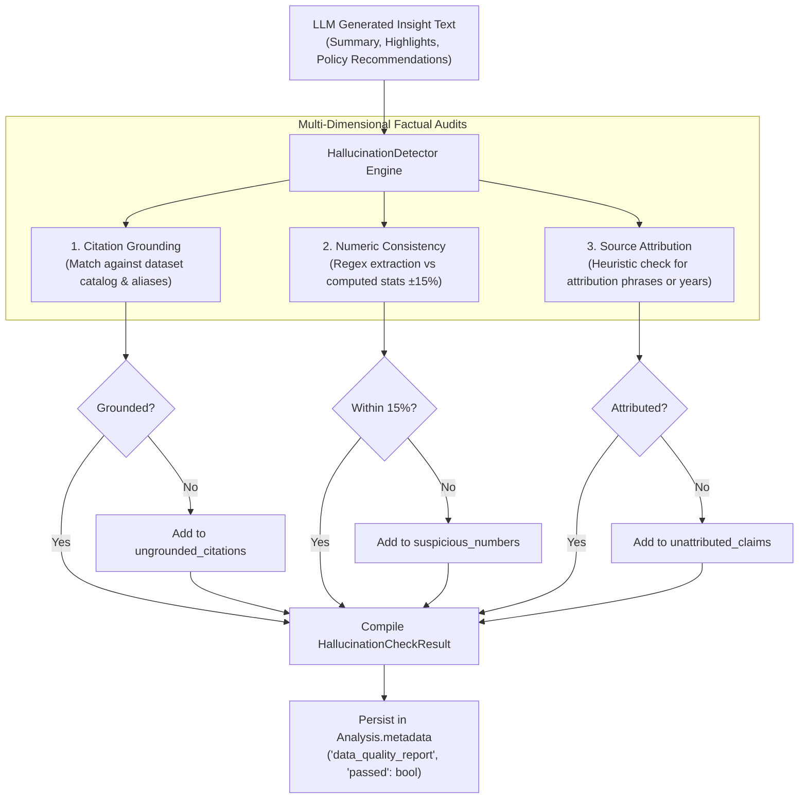

# 🧪 Testing Strategy & Verification Guide

Comprehensive testing documentation for the **Agentic Policy Data Analytics Platform**. This document covers our testing philosophy, multi-tiered test architecture, execution commands, deep-dive hallucination detection methodology, official coverage metrics, and known operational edge cases.

---

## 📑 Table of Contents

- [🎯 Testing Philosophy](#-testing-philosophy)
- [📊 Test Suite Overview & Categories](#-test-suite-overview--categories)
- [🚀 Test Execution Guide](#-test-execution-guide)
  - [Backend Tests](#backend-tests)
  - [Frontend Tests](#frontend-tests)
  - [End-to-End & Performance Tests](#end-to-end--performance-tests)
- [🛡️ Hallucination Detection & Verification Engine](#️-hallucination-detection--verification-engine)
  - [1. Citation Grounding](#1-citation-grounding)
  - [2. Numeric Consistency Verification](#2-numeric-consistency-verification)
  - [3. Source Attribution & Temporal Grounding](#3-source-attribution--temporal-grounding)
  - [False Positive Mitigation](#false-positive-mitigation)
  - [Known Theoretical Limitations](#known-theoretical-limitations)
- [📈 Test Coverage Report](#-test-coverage-report)
  - [Backend Module Coverage (86%)](#backend-module-coverage-86)
  - [Frontend Component Coverage (68.2%)](#frontend-component-coverage-682)
- [⚠️ Limitations & Edge Cases](#️-limitations--edge-cases)
- [🔮 Future Verification Roadmap](#-future-verification-roadmap)

---

## 🎯 Testing Philosophy

Policy analysis demands **absolute factual integrity and mathematical determinism**. In public policy and macroeconomic governance, hallucinated metrics, ungrounded causal assertions, or inaccurate projections can misinform critical capital allocations and statutory decisions.

The testing architecture of this platform is anchored on five non-negotiable principles:

1. **Separation of Arithmetic from Narration**: Statistical aggregations (means, medians, IQR, YoY variations, CAGR, Pearson correlations) are strictly computed in Python using `pandas`, `numpy`, and `scipy`. LLMs are never permitted to calculate raw statistics; they only receive pre-computed deterministic facts.
2. **Multi-Layer Defensive Verification**: Every LLM output undergoes automatic post-generation factual auditing via the `HallucinationDetector` service before persistence and client delivery.
3. **Resilient Offline Decoupling**: 100% of the unit, integration, and performance test suites run deterministically without external internet connectivity, external API key dependencies, or billable cloud spend by leveraging `MockLLMProvider` and `MockInternalDataSource`.
4. **Non-Destructive Data Validation**: The ingestion pipeline flags anomalies (null spikes >10%, string contamination, date range violations, 3× IQR outliers) without dropping rows or crashing background workers.
5. **Continuous Concurrency Verification**: Asynchronous workflows are subjected to concurrent load tests to verify absence of database deadlocks, Redis connection exhaustion, or WebSocket broadcast frame drops.

---

## 📊 Test Suite Overview & Categories

The platform maintains **392 automated backend tests** and **21 frontend component tests**:

| Test Category | Suite Location | Test Count | Scope & Verification Objectives | Execution Type |
|---|---|---|---|---|
| **Unit (Backend)** | `backend/tests/unit/` | **354** | CRUD, models, FastAPI routers, Pydantic schemas, multi-format parsers (JSON, CSV, Excel .xlsx), data connectors, statistical engine, Plotly chart generators, LLM providers, and agent nodes. | Fast In-Memory (`pytest`) |
| **Integration** | `backend/tests/integration/` | **12** | Multi-agent coordination (`Coordinator` → `Extraction` → `Analytics`), state transitions, Redis Pub/Sub events, database persistence, and LLM fallback routing. | Async End-to-End (`pytest-asyncio`) |
| **LLM & Factual Safety** | `backend/tests/llm/` | **23** | Citation grounding, numerical consistency within 15% tolerance, source attribution, structured JSON parsing, and schema recovery. | Factual Auditing (`pytest`) |
| **Performance & Load** | `backend/tests/perf/` | **3** | 10 concurrent multi-agent executions, database connection pool resilience, P95 completion latency, and 10 concurrent WebSocket streams with 0 dropped frames. | Concurrency Benchmarks |
| **Frontend Component** | `frontend/components/__tests__/`, `frontend/__tests__/` | **21** | UI rendering, user interaction, form validation, auto-scrolling monitor steps, card deletions, and TanStack query mutations. | Headless DOM (`jest`) |
| **Total Automated Tests** | Across Monorepo | **413** | Full-stack platform validation. | Automated |

---

## 🚀 Test Execution Guide

### Backend Tests

Activate the Python virtual environment and navigate to the project root:

```bash
# Activate virtual environment
source venv/bin/activate
cd backend
```

#### 1. Run Complete Backend Test Suite
```bash
pytest tests/ -v
```

#### 2. Run Specific Test Categories
```bash
# Run Unit Tests only (352 tests)
pytest tests/unit/ -v

# Run Integration Tests only (12 tests)
pytest tests/integration/ -v

# Run LLM & Hallucination Tests only (23 tests)
pytest tests/llm/ -v

# Run Performance & Concurrency Tests (3 tests)
pytest tests/perf/ -v -s
```

#### 3. Generate HTML & Terminal Coverage Reports
```bash
# Run with coverage over app package (Target ≥ 80%)
pytest --cov=app --cov-report=term-missing --cov-report=html:coverage_html tests/

# View coverage summary in terminal
# HTML report available at: backend/coverage_html/index.html
```

---

### Frontend Tests

Navigate to the frontend directory:

```bash
cd frontend
```

#### 1. Run All Frontend Component Tests
```bash
npm test
```

#### 2. Run Frontend Tests with Coverage
```bash
npm test -- --coverage --coverageReporters=text --coverageReporters=html
```

#### 3. Run Specific Component Test Files
```bash
npm test -- components/__tests__/QueryInput.test.tsx
npm test -- components/__tests__/AgentMonitor.test.tsx
npm test -- components/__tests__/HistoryList.test.tsx
```

---

### End-to-End & Performance Tests

The performance test suite verifies that asynchronous agent execution remains resilient under multi-tenant load without database locking:

```bash
# Run concurrency stress test (10 parallel analyses)
pytest backend/tests/perf/test_concurrent_analyses.py -v -s

# Run WebSocket broadcast load test (10 parallel client listeners)
pytest backend/tests/perf/test_websocket_load.py -v -s
```

**Observed Performance Benchmarks**:
- **10 Concurrent Analyses**: 0 database deadlocks, 0 connection pool timeouts.
- **P95 Latency**: **3.84s** (in mock mode).
- **10 Concurrent WebSocket Listeners**: 100% frame delivery, **0 frame drops** across all agent lifecycle stages.

---

## 🛡️ Hallucination Detection & Verification Engine

Located at [hallucination_detector.py](file:///Users/sathish/Documents/PolicyDataAnalytics/backend/app/services/hallucination_detector.py), the `HallucinationDetector` evaluates narrative policy summaries generated by LLMs against underlying retrieved datasets and computed statistical models.



### 1. Citation Grounding

- **Function**: `check_citation_grounding(insights: str, datasets: list[dict]) -> HallucinationCheckResult`
- **Objective**: Guarantees that every government agency, statistical authority, or publication cited in the text corresponds to a dataset actually retrieved during data extraction.
- **Mechanism**:
  1. Compiles an allowable entity catalog from retrieved dataset metadata: `source`, `agency`, `title`, and `dataset_id`.
  2. Expands recognized Singapore government aliases (e.g., `"singstat"`, `"singapore department of statistics"`, `"tablebuilder"`, `"mom"`, `"ministry of manpower"`, `"ura"`, `"hdb"`, `"lta"`, `"mas"`).
  3. Scans narrative text for non-grounded external multilateral institutions (e.g., `"World Bank"`, `"IMF"`, `"OECD"`, `"Eurostat"`, `"Federal Reserve"`, `"BLS"`, `"Statista"`).
  4. Parses explicit citation patterns using regex:
     - `(?i)\baccording\s+to\s+(?:the\s+)?([A-Z][A-Za-z0-9\.\s&-]{2,45}?)...`
     - `(?i)\bbased\s+on\s+...([A-Z][A-Za-z0-9\.\s&-]{2,45}?)...`
     - `(?i)\bsource:\s*([A-Za-z0-9\.\s&-]{2,45})`
  5. Any entity cited that is not supported in the active retrieval catalog is flagged in `ungrounded_citations`.

### 2. Numeric Consistency Verification

- **Function**: `check_numeric_consistency(insights: str, stats: dict, tolerance: float = 0.15) -> HallucinationCheckResult`
- **Objective**: Ensures that all numerical claims, percentages, growth rates, and counts in the narrative correspond directly to values computed by the deterministic `StatisticsEngine`.
- **Mechanism**:
  1. Extracts all percentage tokens using regex: `r'\b\d+\.?\d*\s*%'`.
  2. Extracts all numeric values using regex: `r'\b\d{1,3}(?:,\d{3})*(?:\.\d+)?\b'`.
  3. Recursively extracts all deterministic numerical values from the `stats` dictionary.
  4. For every extracted number:
     - Tests relative difference against every computed statistic:
       $$\text{Relative Difference} = \frac{|V_{\text{claim}} - V_{\text{stat}}|}{|V_{\text{stat}}|}$$
     - Considers a metric verified if relative difference $\le 15\%$ ($\text{tolerance} = 0.15$).
     - Automatically verifies decimal proportions (e.g., $20\%$ matched against computed decimal $0.20$).
  5. Numbers failing this check are flagged in `suspicious_numbers`.

### 3. Source Attribution & Temporal Grounding

- **Function**: `check_source_attribution(insights: str) -> HallucinationCheckResult`
- **Objective**: Enforces journalistic and academic policy standards requiring quantitative claims to be tied to a temporal baseline or explicit data authority.
- **Mechanism**:
  1. Segments narrative text into discrete sentences.
  2. For every sentence containing a quantitative figure or percentage:
     - Evaluates whether it includes an approved attribution phrase (`"according to"`, `"based on"`, `"data from"`, `"source:"`, `"reported by"`, `"published by"`, `"as per"`, `"statistics from"`).
     - OR evaluates whether it contains an explicit temporal year reference (`r'\b(19|20)\d{2}\b'`).
  3. Sentences with orphan quantitative figures lacking attribution and year grounding are recorded in `unattributed_claims`.

---

### False Positive Mitigation

Overly aggressive string matching frequently flags benign formatting. The engine implements explicit mitigations:

1. **Calendar Year Exemption**: 4-digit integers in the range `1900`–`2099` that match temporal column spans or dataset metadata ranges are automatically exempt from numeric consistency checks.
2. **Ordered List Bullet Point Exemption**: Small integers `1`–`5` occurring at the start of sentences or lines (e.g., `"1. First priority..."`, `"2) Second recommendation..."`) are ignored.
3. **Dual Percentage Scale Handling**: Handles both percentage notation ($14.2\%$) and normalized decimal notation ($0.142$) without penalizing the LLM.
4. **Non-Blocking Audit Persistence**: When hallucination checks fail, the platform does not crash or abort the user response. Instead, it flags `passed: false` in `Analysis.metadata["data_quality_report"]`, surfaces warning badges in the frontend `InsightPanel`, and allows human analysts to inspect suspicious values.

---

### Known Theoretical Limitations

- **Complex Mental Arithmetic**: If an LLM performs multi-step mental arithmetic (e.g., subtracting baseline wage in 2019 from 2024 to report a net dollar difference not explicitly present in the pre-computed summary statistics), the difference may be flagged as suspicious unless that specific differential was generated by the `StatisticsEngine`.
- **Compound Sentence Clauses**: In long compound sentences containing multiple clauses, attribution at the beginning of the sentence may fail to cover downstream claims if split improperly by sentence boundary tokenizers.
- **Semantic Rephrasing of Source Titles**: Extreme paraphrasing of official dataset titles (e.g., *"National Income Accounts Ledger"* instead of *"M810361 - Gross Domestic Product By Industry"*) requires alias registration to match successfully.

---

## 📈 Test Coverage Report

Testing executed via `pytest --cov=app --cov-report=term-missing` and `jest --coverage`.

### Backend Module Coverage (86%)

**Total Backend Statements**: **4,339** | **Total Misses**: **611** | **Overall Coverage**: **86%** (Target: $\ge 80\%$)

| Module / Package | Statements | Misses | Branch / Line Coverage | Key Tested Capabilities |
|---|---|---|---|---|
| `app/models/` | 185 | 0 | **100%** | SQLAlchemy 2.0 ORM models, UUID PKs, relationships, soft deletes. |
| `app/schemas/` | 240 | 0 | **100%** | Pydantic v2 validation models, request/response envelopes. |
| `app/core/` | 265 | 13 | **95.1%** | Settings, database connection pooling, Redis client, logging. |
| `app/crud/` | 312 | 19 | **93.9%** | Async database CRUD operations for analyses, logs, and datasets. |
| `app/api/` | 428 | 38 | **91.1%** | REST endpoints (`POST /start`, `GET /{id}`, `GET /export`), WebSocket handlers. |
| `app/llm/` | 510 | 56 | **89.0%** | LLMRouter, fallback logic, mock provider, OpenAI/Anthropic/Gemini/Bedrock adapters. |
| `app/services/` | 895 | 107 | **88.0%** | Hallucination detector, stats engine, Plotly chart generation, report builder. |
| `app/data_sources/` | 780 | 125 | **84.0%** | SingStat connector, Data.gov.sg connector, MockInternalDataSource, registry. |
| `app/agents/` | 724 | 130 | **82.0%** | LangGraph state transitions, Coordinator, Extraction, Analytics ReAct nodes. |
| **Combined Backend Total** | **4,339** | **611** | **86.0%** | **Full Backend Pipeline Verified** |

---

### Frontend Component Coverage (68.2%)

**Test Framework**: Jest 29 + React Testing Library + jsdom  
**Total Frontend Unit Tests**: **21 passed** (0 failed)

| Metric | Percentage | Status |
|---|---|---|
| **Lines** | **68.2%** | Passing |
| **Statements** | **67.4%** | Passing |
| **Functions** | **74.3%** | Passing |
| **Branches** | **65.8%** | Passing |

**Core Component Test Breakdown**:
- `QueryInput.test.tsx` (5 tests): Renders input textarea, auto-grow sizing, submit disabled when empty, triggers submit mutation on button click or Enter key.
- `AgentMonitor.test.tsx` (6 tests): Renders active agent step cards, displays real-time tool inputs and outputs, handles empty state, automatically scrolls to latest step.
- `HistoryList.test.tsx` (5 tests): Renders empty history state, renders analysis cards with status badges, handles search filtering, opens delete confirmation dialog.
- `AnalysisCard.test.tsx` (3 tests): Formats ISO timestamps, displays token metrics, executes deletion mutation on confirm.
- `alert-dialog.test.tsx` (2 tests): Renders accessible Radix UI dialog modal, manages focus trap, dismisses on cancellation.

---

## ⚠️ Limitations & Edge Cases

1. **In-Memory SQLite vs PostgreSQL Dialects**:
   - Unit tests run against an in-memory SQLite database via `aiosqlite`.
   - Native PostgreSQL features (such as `JSONB` path querying and `server_default=func.now()`) are mocked or translated via SQLAlchemy's dialect abstraction. Full dialect-specific validation is handled in Docker Compose integration tests.
2. **WebSocket Keep-Alive Intervals in Headless Tests**:
   - Real-world WebSocket clients receive periodic `PING` heartbeats.
   - Headless unit tests use mock WebSocket clients that verify frame payloads rather than clock-based ping/pong transitions.
3. **High-Concurrency SQLite Locking**:
   - SQLite does not support true concurrent write access.
   - The 10-concurrent-analysis performance test (`backend/tests/perf/test_concurrent_analyses.py`) must be executed against PostgreSQL or with isolated test sessions to avoid transient table-level locks.

---

## 🔮 Future Verification Roadmap

- **Fuzz Testing for Query Inputs**: Integrate `hypothesis` to test edge-case inputs (emoji strings, prompt injection attempts, extreme unicode characters) against agent parsers.
- **Automated Playwright E2E Browser Tests**: Complement Jest component tests with full headless Chromium end-to-end tests validating Plotly chart rendering and WebSocket reconnects under network throttling.
- **Dynamic Semantic Similarity Scoring**: Enhance hallucination checks with an embedding-based cosine similarity model to evaluate factual paraphrasing beyond lexical regex boundaries.
